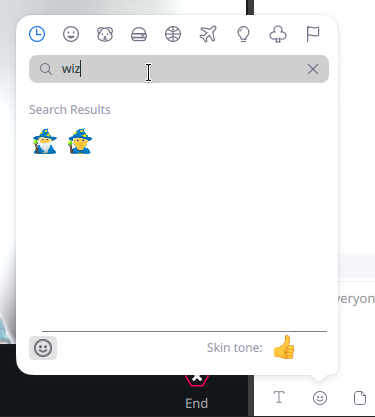
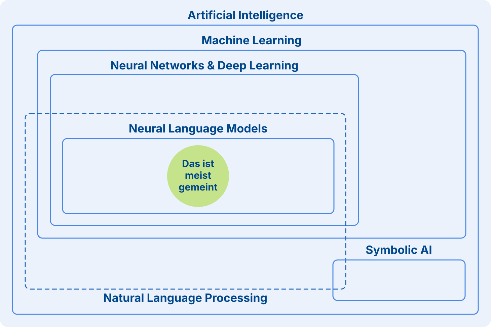

## Hallo 👋 {.ca-upper}

::: ca-team-grid

Jonas

Referent bei CorrelAid

Beratungs- und Umsetzungsteam im Civic Data Lab

<a href="mailto:jonas.s@correlaid.org" style="color:#000; display:inline-flex; align-items:center; gap:0.35em;"><svg width="0.95em" height="0.95em" viewBox="0 0 24 24" fill="none" stroke="currentColor" stroke-width="2" stroke-linecap="round" stroke-linejoin="round" aria-hidden="true"><rect x="2" y="4" width="20" height="16" rx="2"/><path d="m22 7-10 6L2 7"/></svg>jonas.s@correlaid.org</a>

:::

::: notes
- Kurze Vorstellung
:::

## Über CorrelAid {.ca-upper .ca-about}

::: about-grid

CorrelAid

Sascha Schürmann / Salt &amp; Content

CorrelAid hilft Non-Profits dabei, Daten kritisch und reflektiert für ihre Ziele einzusetzen.

<b>Zivilgesellschaft unterstützen</b>Pro-bono Data4Good-Projekte und Beratung für Non-Profits

<b>Datenkompetenz stärken</b>Weiterbildung für Non-Profits und Ehrenamtliche

<b>Community fördern</b>Datenanalyst*innen vernetzen sich online und vor Ort

:::

::: notes
- CorrelAid e.V.: Netzwerk Ehrenamtlicher aus der Zivilgesellschaft für die Zivilgesellschaft
:::

## Schön, dass ihr da seid! {.ca-upper .ca-welcome}

::: ca-welcome-grid

- Die **Folien** findet ihr hier: [correlaid.github.io/power_der_prompts_cdl](https://correlaid.github.io/power_der_prompts_cdl/#/title-slide)
- Lasst uns heute im Workshop gerne beim **Du** bleiben.
- Macht aktiv mit und teilt eure Erfahrungen. Es gibt keine „blöden“ Fragen. Merkt euch eure Fragen: am Ende gibt es Zeit dafür.
:::

::: notes
- Folien-Link zeigt auch die Lösungen von Übung 2, bewusst so gelassen
:::

## Inhalte {.ca-upper .ca-agenda}

<ol class="ca-toc">
<li class="active">01Ankommen & Aktivierung<small>Was kann KI angeblich? · 10 min</small></li>
<li>02KI als Werkzeug: Tasks, Methoden, Prompts<small>Impuls + Übung: Probleme zu Tasks zuordnen · 19 min</small></li>
<li>03Ein KI-Projekt durchführen: Voraussetzungen und Kosten<small>Impuls: Was es braucht und wer die Kosten trägt · 7 min</small></li>
<li>04Abschluss<small>Ausblick & Fragen · 8 min</small></li>
</ol>

::: notes
- Titel-Spannung ansprechen: „Die Power der Prompts klingt nach Hype. Das schauen wir uns heute an.“
- Leitfrage: „Welches Problem haben wir?“ statt „Wie können wir KI einsetzen?“
:::

## Eine Bewertungsskala

::: {style="font-size:1.8em; text-align:center; margin:0.4em 0 0.6em;"}
🧙 Mythos ⟵ 🤔 ⟶ 🦊 Fable(haft)
:::

::: {.skala-pics .skala-pics-wide}
{.pic-light}

{.pic-dark}
:::

::: {style="text-align:center; margin-top:0.6em;"}
🧙 *Mythos im eigentlichen Sinne* · 🤔 *unsicher (müsste ich ChatGPT fragen)* · 🦊 *keine Fabel, sondern fable(haft)*
:::

[@nyt2026mythos · Screenshot: Claude-Modellauswahl, November 2026]{.source}

::: notes
- 2 min
- KI-Hype themed Skala
- „Mythos“ und „Fable“ sind auch Modellnamen von Anthropic (Claude). Mythos Preview galt im April 2026 als zu gefährlich zur Veröffentlichung, seit Juni 2026 verfügbar, Fable mit zusätzlichen Schutzmaßnahmen. Die Namen sind Marketing
- - Skala für Machbarkeit von Versprechen, Wahrheitsgehalt von Aussagen
- „Zu gefährlich“ ist selbst ein Versprechen, das man auf die Skala legen kann und vielleicht links unter Mythos einordnen könnte weil Marketing

:::

## Übung: Vibecheck {.center}

:::: {.columns}

::: {.column width="75%"}
1. Denkt an ein **Versprechen über KI**, das ihr gehört habt (Pitch, Werbung, Förderaufruf, Kolleg*in)
2. Tippt es in den **Chat** + ein Emoji von der Skala: 

🧙 *Mythos im eigentlichen Sinne* · 🤔 *unsicher (müsste ich ChatGPT fragen)* · 🦊 *keine Fabel, sondern fable(haft)*

3. Chatwasserfall: **Enter erst auf mein Los!** 

::: {style="margin-top:0.5em; color:#374151;"}
*Beispiel: „Mit KI spart ihr 10 Stunden pro Woche“ 🧙*
:::
:::

::: {.column width="25%"}
{style="padding-left:1.2em;" fig-alt="Zoom-Emoji-Suche mit dem Suchbegriff ‚wiz‘ und Zauberer-Emojis als Ergebnis"}
:::

::::

::: notes
- 4 min: 1 erklären · 2 tippen, Enter erst auf „Los“ · 1 vorlesen
- Fokus auf Versprechen an die Zivilgesellschaft: Zeit sparen, „kompetitiv bleiben“, Förderfähigkeit
- links schlecht/unrealistisch/fake news, rechts gut/realistisch/machbar
- emojis suchen oder aus meiner nachricht kopieren (chat_texte)
- Ein bis zwei Versprechen vorlesen, möglichst mit unterschiedlichen Emojis, ggf. eine Person fragen, warum

:::

## Was wird versprochen?

- Typische Muster: **Zeit sparen** · **nicht abgehängt werden** · **Effizienz** unter Förderlogiken

::: fragment
- Zwänge in der Zivilgesellschaft: wenig Personal, Projektförderung. Unser Eindruck aus Beratungen: KI-Projekte haben Prestige und bekommen leichter Geld
- Die Kehrseite: Kosten werden verlagert
  - **Workslop**: KI-Output, der nach Arbeit aussieht, die Arbeit aber auf andere verlagert (Umfrage unter US-Büroangestellten)
  - Ressourcenverbrauch, Kognitives Outsourcing, Abhängigkeit: dazu später mehr
:::

[@niederhoffer2025]{.source}

::: notes
- 1,5 min. Erst die Muster nennen, dann per Klick die Kehrseite
- Workslop: Output, der gut aussieht, bei dem andere nacharbeiten müssen
- Kosten nur anteasern, kommt in Block 3 („Wer trägt die Kosten?“)
- Brücke zu Block 2: „Oft ist KI gar nicht nötig“
:::

## Inhalte {.ca-upper .ca-agenda}

<ol class="ca-toc">
<li>01Ankommen & Aktivierung<small>Was kann KI angeblich? · 10 min</small></li>
<li class="active">02KI als Werkzeug: Tasks, Methoden, Prompts<small>Impuls + Übung: Probleme zu Tasks zuordnen · 19 min</small></li>
<li>03Ein KI-Projekt durchführen: Voraussetzungen und Kosten<small>Impuls: Was es braucht und wer die Kosten trägt · 7 min</small></li>
<li>04Abschluss<small>Ausblick & Fragen · 8 min</small></li>
</ol>

::: notes
- Leitfrage: „Welches Problem haben wir?“ statt „Wie können wir KI einsetzen?“
- KI als Werkzeugoption mit Alternativen, das man mit Bezug auf das Problem das man hat bewerten muss
:::

## KI als Werkzeug {.ca-upper .ca-agenda .ca-subtoc}

<ol class="ca-toc">
<li>2.1Tasks<small>Von Fähigkeiten zu Aufgaben und echten Projekten</small></li>
<li>2.2Methoden<small>Ein Task, viele Ansätze</small></li>
<li>2.3Prompts<small>Was Prompts können</small></li>
<li>2.4Messen<small>Einfache Performancemessung</small></li>
<li>2.5Kriterien<small>Wann ist KI sinnvoll? (Teil 1)</small></li>
<li>2.6Übung<small>Probleme zu Tasks zuordnen</small></li>
</ol>

::: notes
- 0,5 min mit Inhalte-Folie. Fahrplan für den längsten Block, nicht vorlesen
:::

## Was ist KI? Intelligenz

> Intelligenz ist der rechnerische Teil der Fähigkeit, Ziele in der Welt zu erreichen. […] Intelligenz umfasst Mechanismen; die KI-Forschung hat herausgefunden, wie Computer **manche davon ausführen können, andere nicht**.

Intelligenz ist also ein **Bündel von Fähigkeiten**: einordnen, lesen, wiederfinden, formulieren, vorausschauen, planen … Manche davon kann *Künstliche* Intelligenz (KI) gut, andere kaum.

[@mccarthy_what_2012, eigene Übersetzung]{.source}

::: notes
- 1 min
- Original: „Intelligence is the computational part of the ability to achieve goals in the world. […] Intelligence involves mechanisms, and AI research has discovered how to make computers carry out some of them and not others.“
- Kein Bewusstsein gemeint, nur zielgerichtete Fähigkeiten
- Beispiel (Moravec-Paradox): Schachcomputer schlägt 1997 den Weltmeister, Roboter, die in einer fremden Küche aufräumen, gibt es bis heute nicht
- Überleitung: „Diese Fähigkeiten sind zu vage. Dafür braucht es Tasks.“
:::

## Von Fähigkeiten zu Tasks {.ca-dense .ca-table .ca-tight}

Ein **Task** legt fest: Was geht rein? Was soll rauskommen? Woran messen wir, ob es stimmt?

| Task | Beispiel: Eingabe → Ausgabe | Wie messen? |
|---|---|---|
| ① Klassifikation | E-Mail → zuständige Person | Anteil richtig zugeordnet |
| ② Informationsextraktion | Rechnung → Betrag, Datum, Absender | Anteil korrekter Felder |
| ③ Texterkennung / Spracherkennung | Formular oder Interview-Audio → Text | Anteil falscher Wörter |
| ④ Suche / Fragen beantworten | Frage → passende Dokumente | Richtiges Dokument unter den Top 5? |
| ⑤ Vereinfachen / Umformulieren | Behördenbrief → Leichte Sprache | Prüfung durch Zielgruppe |
| ⑥ Gruppieren (Clustering) | 2.000 Freitextantworten → Themen | Keine richtige Antwort, daher Plausibilität prüfen |
| ⑦ Dubletten erkennen | Spendendatenbank → doppelte Einträge | Anteil gefundener Dubletten |
| ⑧ Vorhersage / Anomalie | Einsatzdaten → Bedarf morgen | Abweichung, Fehlalarme vs. Übersehene |

::: notes
- 3,5 min. Zentrale Folie: vage Fähigkeit („Sprache verstehen“) vs. klarer Task („Mails einer Person zuordnen“)
- Nummern ①–⑧ kommen in Übung 2 wieder
- ⑧ Fehlalarme vs. Übersehene = Precision/Recall
- Bei Nachfrage: Neuronale Netze seit etwa 2012 bei Bild, Sprache, Text führend [@lecun2015], bei Tabellendaten oft baumbasierte Verfahren [@grinsztajn2022]
- Überleitung: „Wo gibt es diese Tasks in echten Projekten?“
:::

## Typische KI-Projekte nach Task {.ca-dense .ca-table}

| Task | Projekt |
|---|---|
| **① Klassifikation** | [AfD-Gutachten](https://www.afd-gutachten.de/gutachten/03-einfuehrung/04-methodik/02-massenhafte-erhebung-von-primaerdaten/01-quellen/): Äußerungen vorfiltern |
| | [AWO](https://awo.org/projekt/demokratiefoerderung/): Fördert ein Programm Demokratie? |
| **③ Texterkennung** | [genialsozial](https://saechsische-jugendstiftung.de/angebot/genialsozial-aktionstag-einen-tag-arbeiten-und-soziale-projekte-unterstuetzen/): Handschrifterkennung für Formulare |
| **④ Suche / Fragen beantworten** | [Schule ein Gesicht geben](https://civic-data.de/blog/schule-ein-gesicht-geben/): Wissensdatenbank zugänglicher machen |
| **⑤ Vereinfachen** | [Fair Text](https://fair-text.com/assistant-leichte-sprache-uebersetzer/): Texte in Leichte Sprache übersetzen |
| **⑧ Vorhersage / Anomalie** | [BeeObserver](https://correlaid.org/projekte/projektdatenbank/2019-10-BEE): Anomalien im Bienenstock erkennen |

Mehr Projekte: [CDL-Projektsammlung](https://civic-data.de/machen/projektsammlung/) · [CorrelAid-Projektdatenbank](https://correlaid.org/projekte/projektdatenbank)

[@cdl_projektkatalog]{.source}

::: notes
- 2 min. Gleiche Handvoll Tasks hinter sehr unterschiedlichen Themen
- Status laut Katalog (Selbstauskunft): AWO abgeschlossen · genialsozial geprüft · Schule ein Gesicht geben unklar · Fair Text, BeeObserver in Betrieb. Auch hier gilt die Skala
- AfD-Gutachten: KI filtert vor, Menschen prüfen [@verfassungsblog2026]
- AWO: KI nur für einfache Fälle, schwierige entscheiden Menschen [@cdl_demokratiefoerderquote]
- genialsozial: Hauptarbeit ist das digitale Formular, Handschrifterkennung nur als Übergangslösung geprüft
- ② und ⑥ fehlen bewusst, ② kommt in Übung 2 als Praxisbeispiel (EVIM)
- Agents: kein Katalog-Projekt. Eigene Coding-Erfahrung erzählen; kleine Studie: erfahrene Entwickler*innen waren mit KI langsamer, nicht verallgemeinern [@becker2025]
:::

## Was ist KI? Ein Oberbegriff

{fig-align="center" style="max-height:560px;" fig-alt="Verschachtelte Kästen: Künstliche Intelligenz umfasst Machine Learning, darin neuronale Netze und Deep Learning, darin neuronale Sprachmodelle. Daneben symbolische KI (Regeln). Natural Language Processing überschneidet sich mit beiden."}

::: notes
- 0,5 min. KI ist mehr als generative KI. ChatGPT und Claude sind neuronale Sprachmodelle
- Regeln = symbolische KI. Der AI Act zählt einfache regelbasierte Software aber nicht als KI
- Überleitung: „Mit diesen Methoden lassen sich Tasks lösen, oft auf mehrere Arten.“
:::

## Ein Task, viele Ansätze {.ca-dense .ca-table .ca-tight}

Beispiel-Task ①: **E-Mail → zuständige Person**

Von oben nach unten: aufwendiger, teurer, schwerer zu prüfen

| Ansatz | Komplexität | Wie es funktioniert | Im Beispiel |
|---|---|---|---|
| **Regeln** | ● | Menschen schreiben Wenn-dann-Regeln | „Rechnung“ im Betreff → Buchhaltung |
| **Klassisches ML** | ●● | Lernt aus gelabelten Beispielen | Lernt aus 1.000 bereits zugeordneten Mails |
| **Finetuning** | ●●● | Vorhandenes Modell mit eigenen Beispielen nachtrainiert | Kleines Sprachmodell mit euren Mails nachtrainiert |
| **Großes Modell + Prompt** | ●●●● | Anweisung und ein paar Beispiele, Modell bleibt unverändert | „Ordne diese Mail einer Person zu: …“ |
| **RAG** | ●●●●● | Modell sucht erst in euren Dokumenten, dann antwortet es | Sucht im Zuständigkeitsplan, dann Zuordnung |
| **Agent** | ●●●●●● | Modell plant Schritte selbst und nutzt Tools | Liest Mail, prüft Vertretungsplan, leitet weiter |

: {tbl-colwidths="[22,14,32,32]"}

::: {.fragment style="margin-top:0.5em;"}
Welcher Ansatz passt, muss man **ausprobieren und prüfen**.
:::

::: notes
- 1,5 min. Von einfach nach komplex sortiert, kommt als Kriterium 2 wieder
- Agent ist ein Ansatz, kein Task. Ausgabe ist eine Folge von Handlungen, schwer zu messen
- Früher ein Modell pro Task (z.B. BERT) [@devlin2019], heute oft ein großes Modell + Prompt [@brown2020]
- Je größer das Modell, desto mehr externalisierte Kosten
:::

## Was Prompts können {.ca-dense}

- **Task genau beschreiben**, Kategorien definieren
- **3–5 gelabelte Beispiele** mitgeben, aber nicht aus euren Testfällen
- **Ausgabeformat** festlegen (z.B. nur die Kategorie)
- ⚠️ Kleine Änderungen am Prompt oder ein Modell-Update können die Ergebnisse verschieben, also **neu prüfen** [@sclar2024]
- ✗ Rollen („Du bist Expert*in …“) helfen nicht verlässlich [@zheng2024]

::: {.fragment style="font-size:0.85em; margin-top:0.6em;"}
Viele Tasks lassen sich heute mit einem großen Modell + **Prompt** lösen, aber nicht immer am besten. Und Performance ist nicht der einzige wichtige Faktor.
:::

::: notes
- 1 min. Fragment greift den Titel auf: Prompts können viel, sind aber nicht automatisch der beste Ansatz
- Andere Faktoren: Kosten, Datenschutz, Abhängigkeit, Nachvollziehbarkeit, Strom (Block 3)
- Bei Nachfrage: Tabellendaten oft klassische Verfahren, Textklassifikation oft kleine Modelle mit Finetuning [@grinsztajn2022; @bucher2024]
- Beispiele im Prompt = Few-Shot. Nicht aus den Testfällen nehmen, sonst prüft man nur, ob das Modell abschreiben kann
- Überleitung: „Woher wisst ihr, ob der Prompt gut ist? An echten Fällen nachsehen.“
:::

## Einfache Performancemessung {.ca-dense}

**Beispiel:** Ein Sportverein will eingehende Mails automatisch einer Kategorie zuordnen.

Bevor ihr euch auf KI verlasst, ein einfacher Einstieg:

1. **Echte Fälle sammeln**, auch seltene und kritische
2. **Zu zweit einordnen**: Wo seid ihr euch uneinig? Dort sind die Kategorien unklar
3. **Fehler anschauen**: Was geht schief, und wen trifft das?

::: {style="margin-top:1em; color:#374151;"}
*Dies ersetzt keine gründliche Evaluation, die notwendig ist, wenn Fehler Menschen schaden können.*
:::

::: notes
- 1 min, kein Schwerpunkt. Botschaft: nicht dem Versprechen glauben, an eigenen Fällen nachsehen
- Wo Fehler Menschen schaden: größere Stichproben, Fachleute, laufende Kontrolle
- Vor der Einführung messen und nach Modell-Updates wiederholen
- Bei Nachfrage: eher 100 Fälle als 10. Bei 100 Fällen sind 88 % und 92 % kein belastbarer Unterschied (± 6 Prozentpunkte). Öffentliche Benchmarks sagen wenig über euren Task
- Überleitung: „Schauen wir uns drei Mails aus dem Sportverein an.“
:::

## Grenzfälle (Ground Truth) {.ca-dense .ca-table}

**Ground Truth**: die Antwort, die für jeden Fall als richtig festgelegt ist. Damit vergleicht man die Ergebnisse der KI.

**A** Mitgliedschaft · **B** Training & Termine · **C** Spenden & Sponsoring · **D** Sonstiges

| Mail | Passt zu |
|---|---|
| ① „Meine Tochter möchte mitmachen. Gibt es ein Probetraining?“ | [A oder B]{.fragment fragment-index=1} |
| ② „Wir möchten nach dem Turnier den Erlös spenden. Zählt das auch als Mitgliedsbeitrag?“ | [A oder C]{.fragment fragment-index=1} |
| ③ „Mein Sohn wird im Training von anderen Kindern gemobbt. An wen kann ich mich wenden?“ | [keine, landet in D]{.fragment fragment-index=1} |

: {tbl-colwidths="[75,25]"}

::: {.fragment fragment-index=2}
**„Ground Truth“ ist nicht die Wahrheit** Referenz-Labels sind Entscheidungen von Menschen, Kategorien ein vereinfachtes Modell der Wirklichkeit. Gemessen wird immer nur gegen dieses Modell.
:::

::: notes
- 2 min. Rhetorisch fragen: Wie hättet ihr entschieden?
- ① und ②: Was „richtig“ ist, entscheidet, wer die Kategorien definiert. Inhaltliche Entscheidung, keine technische
- ③: Für die wichtigste Mail gibt es keine Kategorie, sie landet in „Sonstiges“. Ein besserer Prompt hilft nicht, wenn die Kategorie fehlt
- Grenzfälle sind dort, wo Fehler wehtun
- Überleitung: „Bevor man überhaupt promptet: Ist es ein Problem für KI?“
:::

## Kriterien: Wann ist KI sinnvoll? (Teil 1) {.ca-dense}

1. Lässt sich das Problem in **klare Tasks** zerlegen?
2. Reicht etwas **Einfacheres**? Zuerst ohne KI, dann die niedrigste Komplexitätsstufe: Regeln → klassisches ML → Finetuning → Prompt → RAG → Agent
3. Kann man **prüfen**, ob es gut genug funktioniert? Was kosten Fehler?

::: {.fragment .ca-list-cont}
4. Liegt das eigentliche Problem **woanders** (z. B. Einsamkeit mit einem Chatbot lösen? → systemisches Problem), sodass Technik es nicht löst?
:::

::: {style="margin-top:1em; color:#374151;"}
*Kriterien 4/7, [später](#kriterien-teil-2) mehr*
:::

::: notes
- 1 min. 1–3 fassen Block 2 zusammen. 4 per Klick: die Frage, die in der Praxis zuerst kommt
- 2: Erst ohne KI (Prozess, Struktur, bessere Website statt Chatbot), dann die einfachste Stufe aus der Tabelle „Ein Task, viele Ansätze“, die laut Messung reicht
- 4: Techno-Solutionismus [@morozov2013]. Fehlende Ressourcen lassen sich nicht wegautomatisieren, ein Chatbot hilft nicht gegen Einsamkeit
- Aus CDL-Beratungen: Chatbot-Anfrage, eigentliches Problem ist oft die Website-Struktur
- Optional: Ehrenamtliche würden KI lieber für Verwaltung als für Social Media nutzen [@cdl_ki_ehrenamt], nicht repräsentativ
- Daten, Infrastruktur und Kosten kommen in Block 3
:::

## Übung: Welcher Task? (1/3)

*Fiktionales Beispiel: Welcher Task?*

::: {style="font-size:1.5em; font-weight:600; margin:0.8em 0 1em; line-height:1.3;"}
Ein Verein bekommt jeden Monat 300 Belege und Rechnungen als PDF und tippt Betrag, Datum und Absender von Hand in die Buchhaltung ab. Das kostet die Kassenwartin zwei Abende im Monat, Tippfehler fallen erst beim Jahresabschluss auf.
:::

**Tasks:** ① Klassifikation · ② Informationsextraktion · ③ Texterkennung · ④ Suche · ⑤ Vereinfachen · ⑥ Gruppieren · ⑦ Dubletten · ⑧ Vorhersage · ✗ kein KI-Task

*Tippt die Nummer in den Chat. Enter erst auf mein Los!*

::: {.fragment style="margin-top:0.6em;"}
**Mögliche Lösung:** ② Informationsextraktion (bei Scans vorher ③) · **Oder einfacher?** Strukturierte E-Rechnungen
:::

::: notes
- 5 min: 1 erklären, dann pro Problem ~1,3 min: tippen, Los, Antworten kurz kommentieren, per Klick Lösung zeigen
- Es gibt nicht die eine richtige Lösung. „Oder einfacher?“ betonen, dort steht oft die bessere Lösung
- Problem vorlesen, alle tippen die Nummer, Enter auf „Los“. Kein Nachfragen, Antworten selbst kurz kommentieren („Viele ②, ein paar ③“)
- Zuordnung: ② (bei Scans vorher ③). Ohne KI: strukturierte E-Rechnungen (XRechnung/ZUGFeRD)
- Aus der Praxis: EVIM liest Kassenbelege per KI aus [@cdl_projektkatalog]
:::

## Übung: Welcher Task? (2/3)

*Fiktionales Beispiel: Welcher Task?*

::: {style="font-size:1.5em; font-weight:600; margin:0.8em 0 1em; line-height:1.3;"}
Eine Tafel hat 4.000 Spender\*innen in drei Excel-Listen, viele doppelt. Manche bekommen drei Dankesbriefe, andere keinen, und niemand weiß, wie viele Spender\*innen es wirklich gibt.
:::

**Tasks:** ① Klassifikation · ② Informationsextraktion · ③ Texterkennung · ④ Suche · ⑤ Vereinfachen · ⑥ Gruppieren · ⑦ Dubletten · ⑧ Vorhersage · ✗ kein KI-Task

*Tippt die Nummer in den Chat. Enter erst auf mein Los!*

::: {.fragment style="margin-top:0.6em;"}
**Mögliche Lösung:** ⑦ Dubletten erkennen · **Oder einfacher?** Regeln (gleiche E-Mail, Name + PLZ), künftig eine Liste
:::

::: notes
- Zuordnung: ⑦. Regeln (gleiche E-Mail, Name + PLZ) schlagen oft ML
- Messen: Stichprobe von Paaren von Hand prüfen
- Datenschutz: Spender*innendaten nicht in ChatGPT kopieren, Vorgriff auf Block 3
:::

## Übung: Welcher Task? (3/3)

*Fiktionales Beispiel: Welcher Task?*

::: {style="font-size:1.5em; font-weight:600; margin:0.8em 0 1em; line-height:1.3;"}
Eine Umfrage unter Ehrenamtlichen liefert 2.000 Freitextantworten. In drei Wochen ist der Bericht an die Förderin fällig, und niemand hat Zeit, alles zu lesen.
:::

**Tasks:** ① Klassifikation · ② Informationsextraktion · ③ Texterkennung · ④ Suche · ⑤ Vereinfachen · ⑥ Gruppieren · ⑦ Dubletten · ⑧ Vorhersage · ✗ kein KI-Task

*Tippt die Nummer in den Chat. Enter erst auf mein Los!*

::: {.fragment style="margin-top:0.6em;"}
**Mögliche Lösung:** ⑥ Gruppieren, ohne richtige Antwort (oder ①, wenn Kategorien feststehen) · **Oder einfacher?** Feste Antwortfelder statt Freitext
:::

::: notes
- Zuordnung: ⑥ (oder ①, wenn Kategorien feststehen). Keine richtige Antwort, also Plausibilität prüfen
:::

## Inhalte {.ca-upper .ca-agenda}

<ol class="ca-toc">
<li>01Ankommen & Aktivierung<small>Was kann KI angeblich? · 10 min</small></li>
<li>02KI als Werkzeug: Tasks, Methoden, Prompts<small>Impuls + Übung: Probleme zu Tasks zuordnen · 19 min</small></li>
<li class="active">03Ein KI-Projekt durchführen: Voraussetzungen und Kosten<small>Impuls: Was es braucht und wer die Kosten trägt · 7 min</small></li>
<li>04Abschluss<small>Ausblick & Fragen · 8 min</small></li>
</ol>

## Voraussetzungen (I) {.ca-dense}

- **Daten** (*Womit arbeitet die KI?*): Gibt es genug echte Fälle, z. B. Mails oder Anträge? Sind sie zugänglich, aktuell, dokumentiert? Personenbezogen?
  - KI arbeitet besser mit **strukturierten** Daten, am besten mit **semantischen**: **Metadaten** beschreiben, was Felder bedeuten oder Dokumente enthalten und wie sie zusammenhängen
  - RAG und Agents sind nur so gut wie die **Dokumente**, die sie finden
- **Labels** (*Wer weiß, was richtig ist?*): Fachleute legen für einen Teil der Fälle die richtige Antwort fest, z. B. die Kategorie jeder Mail. Haben sie dafür Zeit?

::: notes
- Block 3 zusammen 6 min (Inhalte, Voraussetzungen I und II, Was oft vergessen wird, Wer trägt die Kosten?)
- Abgrenzung als Bild: Daten sind die Aufgaben, Labels das Lösungsblatt, Fähigkeiten (nächste Folie) die Person, die korrigiert und nachbessert
- Datenqualität: unstrukturiert (PDFs, Mails) → strukturiert (Tabellen) → semantisch (Felder und Beziehungen beschrieben). Je weiter rechts, desto weniger muss KI raten
- Beispiel Metadaten: Spalte „Status“ mit 1–3 ist strukturiert, erst Metadaten sagen, dass 1 = „aktiv“
- Labels brauchen Fachwissen, nicht Technik: Wer im Verein weiß, welche Kategorie eine Mail hat? Oft genau die Fachkräfte, die schon überlastet sind (→ Kriterium 4). Externe Entwickler*innen können das nicht übernehmen
- Labels: Rückbezug auf die Grenzfälle (Ground Truth). Ohne Lösungsblatt keine Performancemessung
:::

## Voraussetzungen (II) {.ca-dense}

- **Fähigkeiten** (*Wer baut und betreut es?*): einrichten und anbinden, mit den Labels messen, Fehler auswerten, anpassen. Im Team oder extern?
- **Infrastruktur** (*Wo läuft es?*): Wer zahlt, wer wartet? Auch noch im zweiten Jahr?
  - KI braucht **Schnittstellen (APIs)** zu euren Systemen

::: notes
- Fähigkeiten = Technik und Methodik, Labels = Fachwissen. Beides wird gebraucht, oft von verschiedenen Personen
- Schnittstellen: ohne API kopiert jemand von Hand hin und her
- Zweites Jahr: Wer pflegt, wer zahlt die API, wer aktualisiert die Dokumente nach Förderende?
:::

## Was oft vergessen wird {.ca-dense}

- **Schatten-KI**: Mitarbeitende und Ehrenamtliche kopieren vermutlich schon jetzt Daten in ChatGPT. Eine kurze **interne Richtlinie** kann ein guter erster Schritt sein
- **Rechtliche Pflichten**: DSGVO und EU AI Act gelten auch für Vereine, schon wenn eure Leute ChatGPT nutzen. **Informiert euch!**

::: notes
- Keine Rechtsberatung. Botschaft: Es gibt Pflichten, informiert euch
- Bei Nachfrage: DSGVO → Auftragsverarbeitungsvertrag, Ort der Verarbeitung. AI Act Art. 4 (seit Feb. 2025): Wer KI einsetzt, fördert die KI-Kompetenz von Personal und Ehrenamtlichen. Seit 27.07.2026 nur noch Unterstützungspflicht (VO (EU) 2026/1744)
- Wer seine Leute ChatGPT nutzen lässt, gilt als „Betreiber“ → Brücke zur Schatten-KI und zum Code of Conduct
:::

## Wer trägt die Kosten? {.ca-dense}

:::: {.columns}

::: {.column width="58%"}
- **Bias & Diskriminierung**
- **Ressourcenverbrauch**: Rechenzentren insgesamt (nicht nur KI) könnten 2030 so viel Strom brauchen wie Japan heute, knapp 3 % des weltweiten Verbrauchs [@iea2025].  Rechenzentren belasten lokal Stromnetz, Wasser und Luft
- **Ausbeutung**: Klickarbeit beim Datenlabeling [@perrigo2023]
:::

::: {.column width="42%"}
::: {style="color:#4b5563; font-size:0.85em;"}
**Zum Nachlesen**

- **Cognitive Outsourcing**: Ersetzt KI Denkprozesse? [@jose2025]
- **Big Tech**: Machtkonzentration, politische Agenda [@kak2023]
:::
:::

::::

::: notes
- Nur die linke Spalte besprechen, rechts zum Nachlesen
- Bias-Beispiel: Sprachmodelle bewerteten in einer Studie Menschen schlechter, die African American English schreiben [@hofmann2024]. Für deutsche Dialekte nicht untersucht, trotzdem ein Grund, selbst zu messen
- Weiteres Bias-Beispiel: Gesichtserkennung erkennt dunkelhäutige Frauen schlechter [@buolamwini2018]
- KI ist durch ihre Herstellung auch politisch [@keymolen2026]. Boykott ist eine begründbare individuelle Entscheidung
:::

## Kriterien: Wann ist KI sinnvoll? (Teil 2) {#kriterien-teil-2 .ca-dense}

*1–4:* klarer Task? · reicht etwas Einfacheres? · prüfbar, ob es gut genug ist? · Problem liegt woanders?

5. Sind **Daten, Labels, Fähigkeiten und Infrastruktur** vorhanden?
6. Ist der **rechtliche Rahmen** geklärt (Datenschutz, EU AI Act) und sind **Betroffene** beteiligt?
7. Stehen Nutzen und **externalisierte Kosten** in einem vertretbaren Verhältnis?

::: notes
- 30 s, nur vorlesen
- Jetzt vollständig, kommt auf „Mitnehmen“ als Liste wieder
- 5 fasst die Folien „Voraussetzungen (I, II)“ zusammen (Daten, Labels, Fähigkeiten, Infrastruktur)
- 6: rechtlicher Rahmen = DSGVO und EU AI Act, siehe „Was oft vergessen wird“
:::

## Inhalte {.ca-upper .ca-agenda}

<ol class="ca-toc">
<li>01Ankommen & Aktivierung<small>Was kann KI angeblich? · 10 min</small></li>
<li>02KI als Werkzeug: Tasks, Methoden, Prompts<small>Impuls + Übung: Probleme zu Tasks zuordnen · 19 min</small></li>
<li>03Ein KI-Projekt durchführen: Voraussetzungen und Kosten<small>Impuls: Was es braucht und wer die Kosten trägt · 7 min</small></li>
<li class="active">04Abschluss<small>Ausblick & Fragen · 8 min</small></li>
</ol>

## Mitnehmen {#kriterien-liste .ca-dense}

Statt *„Wie können wir KI einsetzen?“* lieber *„Welches Problem haben wir?“*

1. Lässt sich das Problem in **klare Tasks** zerlegen?
2. Reicht etwas **Einfacheres**? Zuerst ohne KI, dann die niedrigste Komplexitätsstufe: Regeln → klassisches ML → Finetuning → Prompt → RAG → Agent
3. Kann man **prüfen**, ob es gut genug funktioniert? Was kosten Fehler?
4. Liegt das eigentliche Problem **woanders** (z. B. Einsamkeit mit einem Chatbot lösen? → systemisches Problem), sodass Technik es nicht löst?
5. Sind **Daten, Labels, Fähigkeiten und Infrastruktur** vorhanden?
6. Ist der **rechtliche Rahmen** geklärt (Datenschutz, EU AI Act) und sind **Betroffene** beteiligt?
7. Stehen Nutzen und **externalisierte Kosten** in einem vertretbaren Verhältnis?

::: notes
- 1,5 min mit Inhalte-Folie. Wortlaut 1–4 wie auf „Kriterien (Teil 1)“, 5–7 wie auf „Kriterien (Teil 2)“
- Titel-Spannung auflösen: Prompts können viel, aber das Problem klären und das Ergebnis prüfen bleibt unsere Arbeit
:::

## Weiterführend {.ca-dense}

:::: {.columns}

::: {.column width="50%"}
**Code of Conduct Demokratische KI** [demokratische-ki.de](https://demokratische-ki.de/)

::: {.coc-grid .coc-small}
<figure><figcaption>Abwägung der Nutzung</figcaption></figure>
<figure><figcaption>Menschenzentrierung</figcaption></figure>
<figure><figcaption>Transparenz</figcaption></figure>
<figure><figcaption>Teilhabe und Partizipation</figcaption></figure>
<figure><figcaption>Diskriminierungskritische Haltung</figcaption></figure>
<figure><figcaption>Verantwortung und Verantwortlichkeit</figcaption></figure>
<figure><figcaption>Kompetenzen</figcaption></figure>
<figure><figcaption>Ökologische Nachhaltigkeit</figcaption></figure>
:::
:::

::: {.column width="50%" style="font-size:0.85em;"}
**Workshop: KI-Leitlinien für euren Verein** Do., 3. Dezember, 17:00–18:30 Uhr, online

*KI-Nutzung vereinheitlichen… womit? Leitlinien für eure Organisation entwickeln.* Erste Bausteine für eigene Leitlinien, mit Vorlagen und Beispielen

**Anmeldung:** [correlaid.org/veranstaltungen/ws-ki-5](https://correlaid.org/veranstaltungen/ws-ki-5)

Im Rahmen des Projekts <b>„KI im Engagement“</b>

:::

::::

::: notes
- 1,5 min
- Code of Conduct, max. 30 s: „Acht Prinzipien, mitentwickelt von CorrelAid, Link in den Folien.“
- Workshop: Sagen: „Das machen wir im Rahmen des Projekts ‚KI im Engagement‘, gefördert von der Deutschen Stiftung für Engagement und Ehrenamt (DSEE).“
- Beide Links stehen auch in der Abschlussnachricht im Chat
:::

# Zeit für Fragen

::: {style="font-size:0.7em; margin-top:1.5em;"}
Tiefergehende Fragen zu eurem Projekt? Bucht euch einen kostenlosen Termin in der **Datensprechstunde**: [zeeg.me/correlaid/dss-cdl](https://zeeg.me/correlaid/dss-cdl)
:::

::: notes
- Datensprechstunde: 30 min, kostenlos, Link steht auch in der Abschlussnachricht im Chat
- 5 min. Direkt zu Beginn die Abschlussnachricht mit Links in den Chat posten (chat_texte.md Nr. 2)
- Falls keine Fragen kommen, ans Plenum zurückgeben (Chat-Wasserfall): „Denkt an ein KI-Projekt bei euch. Welches Kriterium (1–7) wäre am schwierigsten?“ Zwei Antworten aufgreifen
- Muster aus der Praxis: KI für die Fachkraft statt für die Betroffenen
- Kriterium 7 heißt nicht nur „Wer zahlt die Rechnung?“, sondern auch: Wer trägt Risiko, Prüfarbeit, Umweltkosten?
:::

## Quellen {.scrollable}

::: {#refs}
:::
