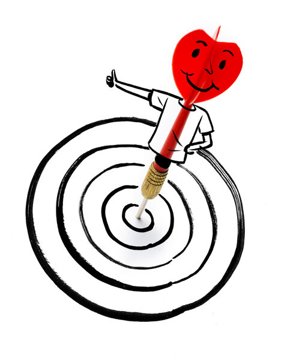
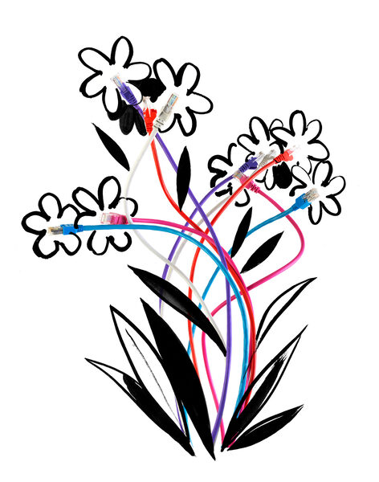

## Hallo 👋 {.ca-upper}

::: ca-team-grid
<div class="ca-person"><div class="ring"></div><div class="name">Jonas</div><div class="role">Referent für Digitale Infrastruktur bei CorrelAid</div></div>
:::

::: notes
- Kurze Vorstellung
:::

## Über CorrelAid {.ca-upper .ca-about}

::: about-grid
<div class="photos">
<div class="ph-wrap"><span class="credit">CorrelAid</span></div>
<div class="ph-wrap"><span class="credit">Sascha Schürmann / Salt &amp; Content</span></div>
</div>
<div class="about-text">
<p class="lead">CorrelAid hilft Non-Profits dabei, Daten kritisch und reflektiert für ihre Ziele einzusetzen.</p>
<div class="pillar"><b>Zivilgesellschaft unterstützen</b>Pro-bono Data4Good-Projekte und Beratung für Non-Profits</div>
<div class="pillar"><b>Datenkompetenz stärken</b>Weiterbildung für Non-Profits und Ehrenamtliche</div>
<div class="pillar"><b>Community fördern</b>Datenanalyst*innen vernetzen sich online und vor Ort</div>
</div>
:::

::: notes
- CorrelAid e.V.: Netzwerk datenbegeisterter Ehrenamtlicher aus der Zivilgesellschaft für die Zivilgesellschaft
- Civic Data Lab: Beratung und Projektbegleitung zu Daten & KI für gemeinwohlorientierte Organisationen
:::

## Schön, dass ihr da seid! {.ca-upper .ca-welcome}

::: ca-welcome-grid


- Die **Folien** findet ihr hier: [correlaid.github.io/power_der_prompts_d3](https://correlaid.github.io/power_der_prompts_d3/#/title-slide)
- Lasst uns heute im Workshop gerne beim **Du** bleiben.
- Es gibt keine „blöden“ Fragen. Macht aktiv mit und teilt eure Erfahrungen. Merkt euch eure Fragen: am Ende gibt es Zeit dafür.
:::

::: notes
- Achtung: Über den Folien-Link kann man die Lösungen (z.B. „Mögliche Zuordnungen“) vorab sehen. Link ggf. erst nach dem Workshop freischalten
:::

## Inhalte {.ca-upper .ca-agenda}

<ol class="ca-toc">
<li class="active"><span class="num">01</span><span class="label">Ankommen & Aktivierung<small>Was kann KI angeblich? · 7 min</small></span></li>
<li><span class="num">02</span><span class="label">KI als Werkzeug: Tasks, Methoden, Prompts<small>Impuls + Übung: Probleme zu Tasks zuordnen · 20 min</small></span></li>
<li><span class="num">03</span><span class="label">Ein KI-Projekt durchführen: Daten, Infrastruktur, Kosten<small>Impuls + Übung: KI-Projekte unter der Lupe · 20 min</small></span></li>
<li><span class="num">04</span><span class="label">Abschluss<small>Ausblick & Fragen · 8 min</small></span></li>
</ol>

::: notes
- Workshop: 3 Übungen, Teilnehmende sollen aktiv mitmachen
- Titel-Spannung offen ansprechen: „Die Power der Prompts klingt nach Hype. Das schauen wir uns heute an.“
- Leitfrage: „Welches Problem haben wir?“ statt „Wie können wir KI einsetzen?“
- Zeiten: 6,5 Block 1 (2 Begrüßung bis Inhalte · 0,5 Skala · 3 Vibecheck · 1 Versprechen) · 5,5 Konzepte (Intelligenz, Tasks, Ansätze, Prompts) · 2 Projekte & Oberbegriff (Projekttabelle 1,5 · Oberbegriff 0,5) · 1,5 Prompt-Folie · 1 Performancemessung · 1,5 Grenzfälle · 1 Kriterien Teil 1 · 7 Übung 2 · 5 Daten & Kosten · 0,5 Kriterien Teil 2 · 14 Übung 3 · 8 Abschluss (2 CoC + Mitnehmen · 6 Fragen) = 53,5
- Rest 1,5 min Puffer: nicht für Inhalt verplanen, ist für die Breakout-Übergaben (Simulation: 1–1,5 min pro Raum)
- Fragen sammeln wir fürs Ende (siehe Folie „Schön, dass ihr da seid!“). Die 6 min Fragerunde nicht als Puffer verbrauchen: bei Verzug lieber kürzen
- Big-Tech-Folie ist ausgeblendet. Weiter kürzen in dieser Reihenfolge: 1. Bonus-Problem Übung 2 · 2. Oberbegriff-Grafik überspringen · 3. Projekttabelle nur zeigen, nicht besprechen · 4. Prompt-Folie überspringen und den Unterschied mündlich nennen · 5. Intelligenz-Folie überspringen, direkt zu den Tasks · 6. „Was oft vergessen wird“ nur kurz anreißen
:::


## Die Skala

::: {style="font-size:1.8em; text-align:center; margin:0.4em 0 0.6em;"}
🧙 Mythos ⟵ 🤔 ⟶ 🦊 Fable(haft)
:::

::: {.skala-pics .skala-pics-wide}
{.pic-light}

{.pic-dark}
:::

::: {style="text-align:center; margin-top:0.6em;"}
🧙 **nicht belegt** · 🤔 **kommt drauf an** · 🦊 **nachweisbar nützlich**
:::

[@nyt2026mythos · Screenshot: Claude-Modellauswahl, November 2026]{.source}

::: notes
- 30 s für die ganze Folie
- Wortspiel laut aussprechen: gemeint ist „fabelhaft“ (= super), nicht „Fabel“ (die ist ja auch erfunden)
- Ein Satz zur Anspielung: „Mythos“ und „Fable“ heißen auch Modelle der Firma Anthropic (Claude). KI-Firmen benennen ihre Produkte selbst nach Erzählungen
- Im April 2026 hielt Anthropic „Mythos Preview“ für zu gefährlich zur Veröffentlichung, seit Juni 2026 sind Mythos-Modelle verfügbar. Fable ist dasselbe Modell mit zusätzlichen Schutzmaßnahmen. Die Namen sind also Marketing
- „Zu gefährlich“ ist selbst ein Versprechen, das man auf die Skala legen kann
:::

## Übung: Vibecheck {.center}

1. Denkt an ein **Versprechen über KI**, das ihr gehört habt (Pitch, Werbung, Förderaufruf, Kolleg*in)
2. Tippt es in den **Chat** + ein Emoji von der Skala: 🧙 / 🤔 / 🦊
3. **Enter erst auf mein Los!**

::: {style="margin-top:1em; color:#374151;"}
*Beispiel: „Mit KI spart ihr 10 Stunden pro Woche“ 🧙*
:::

::: notes
- 3 min Übung (Skala ist auf der Folie davor erklärt)
- Chat-Wasserfall: alle tippen, Enter erst auf „Los“, dann kommen alle Antworten gleichzeitig
- Nur zwei Versprechen vorlesen, möglichst mit unterschiedlichen Emojis; eine Person fragen, warum
- Diese zwei Versprechen auf der nächsten Folie aufgreifen (Chat bleibt stehen)
- Fokus auf Versprechen an Zivilgesellschaft: Zeiteinsparung, „kompetitiv bleiben“, Förderfähigkeit
:::

## Was wird versprochen?

- Eure Versprechen aus dem Chat: …
- Typische Muster: **Zeit sparen** · **nicht abgehängt werden** · **Effizienz** unter Förderlogiken

::: fragment
- Zwänge in der Zivilgesellschaft: wenig Personal, Projektförderung. Unser Eindruck aus Beratungen: KI-Projekte haben Prestige und bekommen leichter Geld
- Die Kehrseite: Kosten werden verlagert
  - **Workslop**: KI-Output, der nach Arbeit aussieht, die Arbeit aber auf andere verlagert (Umfrage unter US-Büroangestellten)
  - Ressourcenverbrauch, Kognitives Outsourcing, Abhängigkeit: dazu später mehr
:::

[@niederhoffer2025]{.source}

::: notes
- Live-Folie: die zwei Versprechen aus dem Chat („Vorhin hat jemand geschrieben …“) den Mustern zuordnen
- Optional: ein verifiziertes echtes Beispiel ergänzen (z.B. aus einem Förderaufruf)
- Workslop: KI-generierter Output, der gut aussieht, bei dem andere aber nacharbeiten müssen
- Externalisierte Kosten nur anteasern, nicht ausführen: kommt in Block 3 („Wer trägt die Kosten?“)
- „Projekte, in denen KI unnötig ist“ mündlich als Brücke zu Block 2 (KI als Werkzeug)
:::

## Inhalte {.ca-upper .ca-agenda}

<ol class="ca-toc">
<li><span class="num">01</span><span class="label">Ankommen & Aktivierung<small>Was kann KI angeblich? · 7 min</small></span></li>
<li class="active"><span class="num">02</span><span class="label">KI als Werkzeug: Tasks, Methoden, Prompts<small>Impuls + Übung: Probleme zu Tasks zuordnen · 20 min</small></span></li>
<li><span class="num">03</span><span class="label">Ein KI-Projekt durchführen: Daten, Infrastruktur, Kosten<small>Impuls + Übung: KI-Projekte unter der Lupe · 20 min</small></span></li>
<li><span class="num">04</span><span class="label">Abschluss<small>Ausblick & Fragen · 8 min</small></span></li>
</ol>

## KI als Werkzeug {.ca-upper .ca-agenda .ca-subtoc}

<ol class="ca-toc">
<li><span class="num">2.1</span><span class="label">Tasks<small>Von Fähigkeiten zu Aufgaben und echten Projekten</small></span></li>
<li><span class="num">2.2</span><span class="label">Methoden<small>Ein Task, viele Ansätze</small></span></li>
<li><span class="num">2.3</span><span class="label">Prompts<small>Prompt als Variable</small></span></li>
<li><span class="num">2.4</span><span class="label">Messen<small>Einfache Performancemessung</small></span></li>
<li><span class="num">2.5</span><span class="label">Kriterien<small>Wann ist KI sinnvoll? (Teil 1)</small></span></li>
<li><span class="num">2.6</span><span class="label">Übung<small>Probleme zu Tasks zuordnen</small></span></li>
</ol>

::: notes
- Fahrplan für den längsten Block: kurz durchgehen, nicht vorlesen
:::

## Was ist KI? Intelligenz

> Intelligenz ist der rechnerische Teil der Fähigkeit, Ziele in der Welt zu erreichen. […] Intelligenz umfasst Mechanismen; die KI-Forschung hat herausgefunden, wie Computer **manche davon ausführen können, andere nicht**.

*Künstliche* Intelligenz (KI) ist also ein **Bündel von Fähigkeiten**: einordnen, lesen, wiederfinden, formulieren, vorausschauen, planen … Manche davon kann KI gut, andere kaum.

[@mccarthy_what_2012, eigene Übersetzung]{.source}

::: notes
- Original: „Intelligence is the computational part of the ability to achieve goals in the world. […] Intelligence involves mechanisms, and AI research has discovered how to make computers carry out some of them and not others.“
- Intelligenz meint hier kein künstliches menschliches Bewusstsein, nur ein Bündel von Fähigkeiten, die auf ein Ziel gerichtet sind
- Beispiel für „manche ja, andere nicht“ (Moravec-Paradox): Ein Schachcomputer schlägt 1997 den Weltmeister. Roboter, die zuverlässig und günstig in einer fremden Küche aufräumen, gibt es bis heute nicht. Was für uns schwer ist, kann für Maschinen leicht sein, und umgekehrt
- Überleitung: „Diese Fähigkeiten sind noch zu vage, um damit zu arbeiten. Dafür braucht es Tasks.“
:::

## Von Fähigkeiten zu Tasks {.ca-dense .ca-table .ca-tight}

Ein **Task** legt fest: Was geht rein? Was soll rauskommen? Woran messen wir, ob es stimmt?

| Task | Beispiel: Eingabe → Ausgabe | Wie messen? |
|---|---|---|
| ① Klassifikation | E-Mail → zuständige Person | Anteil richtig, Fehlalarme vs. Übersehene |
| ② Informationsextraktion | Rechnung → Betrag, Datum, Absender | Anteil korrekter Felder |
| ③ Texterkennung / Spracherkennung | Formular oder Interview-Audio → Text | Anteil falscher Wörter |
| ④ Suche / Fragen beantworten | Frage → passende Dokumente | Richtiges Dokument unter den Top 5? |
| ⑤ Vereinfachen / Umformulieren | Behördenbrief → Leichte Sprache | Prüfung durch Zielgruppe |
| ⑥ Gruppieren (Clustering) | 2.000 Freitextantworten → Themen | Keine richtige Antwort, daher Plausibilität prüfen |
| ⑦ Dubletten erkennen | Spendendatenbank → doppelte Einträge | Anteil gefundener Dubletten |
| ⑧ Vorhersage / Anomalie | Einsatzdaten → Bedarf morgen | Abweichung, Fehlalarme vs. Übersehene |

::: notes
- Zentrale Folie des Workshops: vage Fähigkeit („Sprache verstehen“) vs. klarer Task („Mails einer Person zuordnen“)
- Die Nummern ①–⑧ kommen in Übung 2 wieder
- Überleitung: „Wo gibt es diese Tasks in echten Projekten?“
- Von der Wissenschaft lernen: KI-Methoden werden für Tasks entwickelt und mit eigens zusammengestellten Daten und Metriken verglichen
- Wie man prüft, ob es gut genug ist, kommt nach der Prompt-Folie (nur kurz)
- Neuronale Netze sind seit etwa 2012 bei vielen dieser Tasks führend, vor allem bei Bild, Sprache und Text [@lecun2015]. Bei Tabellendaten sind baumbasierte Verfahren oft besser [@grinsztajn2022]
:::

## Typische KI-Projekte nach Task {.ca-dense .ca-table}

| Task | Projekt |
|---|---|
| **① Klassifikation** | [AfD-Gutachten](https://www.afd-gutachten.de/gutachten/03-einfuehrung/04-methodik/02-massenhafte-erhebung-von-primaerdaten/01-quellen/): Äußerungen vorfiltern |
| | [AWO](https://awo.org/projekt/demokratiefoerderung/): Fördert ein Programm Demokratie? |
| **③ Texterkennung** | [genialsozial](https://saechsische-jugendstiftung.de/angebot/genialsozial-aktionstag-einen-tag-arbeiten-und-soziale-projekte-unterstuetzen/): Handschrifterkennung für Formulare |
| **④ Suche / Fragen beantworten** | [Schule ein Gesicht geben](https://civic-data.de/blog/schule-ein-gesicht-geben/): Wissensdatenbank zugänglicher machen |
| **⑤ Vereinfachen** | [Fair Text](https://fair-text.com/assistant-leichte-sprache-uebersetzer/): Texte in Leichte Sprache übersetzen |
| **⑧ Vorhersage / Anomalie** | [BeeObserver](https://correlaid.org/projekte/projektdatenbank/2019-10-BEE): Anomalien im Bienenstock erkennen |

Mehr Projekte: [CDL-Projektsammlung](https://civic-data.de/machen/projektsammlung/) · [CorrelAid-Projektdatenbank](https://correlaid.org/projekte/projektdatenbank)

[@cdl_projektkatalog]{.source}

::: notes
- Gleiche Handvoll Tasks hinter sehr unterschiedlichen Themen
- Stand laut Katalog (Selbstauskunft): AWO abgeschlossen · genialsozial wird geprüft · Schule ein Gesicht geben unbekannt · Fair Text, BeeObserver in Betrieb. Vieles ist Idee oder Prototyp, auch hier gilt die Skala vom Anfang
- Fehlalarme vs. Übersehene = Precision/Recall in einfachen Worten
- ② und ⑥ bewusst nicht auf der Folie. Echte Beispiele kommen in Übung 2 als Auflösung (Kassenführung EVIM, Full Fact). Für ⑦ kein Katalogbeispiel
- Demokratieförderquote: nur bei einfachen Entscheidungen auf KI verlassen, schwierige Fälle Menschen überlassen
- AfD-Gutachten: KI filtert Äußerungen vor, Menschen prüfen [@verfassungsblog2026]. Weiteres Klassifikations-Beispiel: In safe hands (CorrelAid), Interviewantworten kategorisieren
- Weitere Beispiele aus dem Katalog: KIA (Anfrage klassifizieren, dann Hinweise für Berater*innen generieren)
- KAIMo (Kinderschutz, eingestellt) als Beispiel für einen schwer messbaren Task. Projektseite vorher lesen
- Katalog: Status-Angaben teils Selbstauskunft
- AWO Demokratieförder-Rechner [@cdl_demokratiefoerderquote]
- genialsozial: Handschrift-Digitalisierung nur geprüft, Hauptarbeit ist das digitale Formular. Handschrifterkennung wäre ein bewusst akzeptierter, temporärer Tech-Fix
- Agents: Kein Katalog-Projekt ist agentisch. Stattdessen von eigener Coding-Erfahrung erzählen. Kleine Studie: erfahrene Entwickler*innen waren mit KI langsamer, nicht verallgemeinern [@becker2025]
:::

## Was ist KI? Ein Oberbegriff

{fig-align="center" style="max-height:560px;" fig-alt="Verschachtelte Kästen: Künstliche Intelligenz umfasst Machine Learning, darin neuronale Netze und Deep Learning, darin neuronale Sprachmodelle. Daneben symbolische KI (Regeln). Natural Language Processing überschneidet sich mit beiden."}

::: notes
- KI als Oberbegriff: Wenn eine Technologie eine dieser Fähigkeiten abdeckt, ist sie KI
- KI umfasst mehr als generative KI (ChatGPT, Claude). GPT und Claude sind neuronale Sprachmodelle
- Breite Definition ist wissenschaftlich üblich. Der AI Act grenzt aber einfache regelbasierte Software aus. Für die Art.-4-Pflicht zählt die AI-Act-Definition
- Bild zeigt Methoden, nicht Fähigkeiten. Symbolic AI = Regeln, der erste Ansatz auf der nächsten Folie
- Überleitung: „Mit diesen Methoden lassen sich Tasks lösen, oft auf mehrere Arten.“
:::

## Ein Task, viele Ansätze {.ca-dense .ca-table .ca-tight}

Beispiel-Task ①: **E-Mail → zuständige Person**

| Ansatz | Wie es funktioniert | Im Beispiel |
|---|---|---|
| **Regeln** | Menschen schreiben Wenn-dann-Regeln | „Rechnung“ im Betreff → Buchhaltung |
| **Klassisches ML** | Lernt aus gelabelten Beispielen | Lernt aus 1.000 bereits zugeordneten Mails |
| **Finetuning** | Vorhandenes Modell mit eigenen Beispielen nachtrainiert | Kleines Sprachmodell mit euren Mails nachtrainiert |
| **Großes Modell + Prompt** | Anweisung und ein paar Beispiele, Modell bleibt unverändert | „Ordne diese Mail einer Person zu: …“ |
| **RAG** | Modell sucht erst in euren Dokumenten, dann antwortet es | Sucht im Zuständigkeitsplan, dann Zuordnung |
| **Agent** | Modell plant Schritte selbst und nutzt Tools | Liest Mail, prüft Vertretungsplan, leitet weiter |

::: {.fragment style="margin-top:0.5em;"}
Welcher Ansatz passt, muss man **ausprobieren und prüfen**.
:::

::: notes
- Tabelle ist von einfach nach komplex sortiert. Das kommt als Kriterium 2 wieder: mit der einfachsten Stufe anfangen, die reicht
- Agent ist ein Ansatz, kein Task. Die Ausgabe ist eine Folge von Handlungen und deshalb viel schwerer zu messen. Merken für Übung 3 (Projekt D)
- Regeln vs. AI Act: Brücke zur Art.-4-Folie in Block 3
- RAG und Agent werden in Übung 3 (Projekte B und D) gebraucht
- Früher: ein Modell pro Task, extra dafür trainiert (z.B. BERT) [@devlin2019]; heute oft: ein großes generatives Modell + Prompt, das Modell wird nicht verändert [@brown2020]
- Nur bei Nachfrage: BERT 340 Mio. Parameter, Finetuning; große generative Modelle legen Parameterzahl nicht offen (Schätzungen: Billionen); Zero-/Few-Shot Prompting, In-Context Learning
- Performance nicht als gegeben ansehen; je größer das Modell, desto mehr externalisierte Kosten
:::

## Was Prompts können {.ca-dense}

- **Task genau beschreiben**, Kategorien definieren
- **3–5 gelabelte Beispiele** mitgeben, aber nicht aus euren Testfällen
- **Ausgabeformat** festlegen (z.B. nur die Kategorie)
- ⚠️ Kleine Änderungen am Prompt oder ein Modell-Update können die Ergebnisse verschieben, also **neu prüfen** [@sclar2024]
- ✗ Rollen („Du bist Expert*in …“) helfen nicht verlässlich [@zheng2024]

::: {.fragment style="font-size:0.85em; margin-top:0.6em;"}
Viele Tasks lassen sich heute mit einem großen Modell + **Prompt** lösen, aber nicht immer am besten. Und Performance ist nicht der einzige wichtige Faktor.
:::

::: notes
- Fragment greift den Titel auf: Prompts können viel, sind aber nicht automatisch der beste Ansatz
- Nur bei Nachfrage: Bei Tabellendaten gewinnen oft klassische Verfahren, bei Textklassifikation oft kleine Modelle mit Finetuning [@grinsztajn2022; @bucher2024]
- Andere Faktoren: Kosten, Datenschutz, Abhängigkeit von Anbietern, Nachvollziehbarkeit, Strom (kommt in Block 3)
- Beispiele im Prompt = Few-Shot Prompting
- Erst ein festes Ausgabeformat macht Ergebnisse messbar
- Beispiele nicht aus den Testfällen nehmen, sonst prüft man nur, ob das Modell abschreiben kann
- Überleitung: „Woher wisst ihr, ob der Prompt gut ist? Nachsehen, an echten Fällen.“
:::

## Prompt als Variable {.ca-dense .ca-prompts}

Sportverein: Eingehende Mails automatisch einer Kategorie zuordnen

:::: {.columns}

::: {.column width="42%"}
**Prompt 1**: nur die Kategorien

```{.text code-line-numbers="false"}
Ordne die E-Mail einer Kategorie zu:
A Mitgliedschaft
B Training & Termine
C Spenden & Sponsoring
D Sonstiges
Antworte nur mit dem Buchstaben.
```
:::

::: {.column width="58%"}
**Prompt 2**: Definitionen, 3 Beispiele, Format

```{.text code-line-numbers="false"}
Ordne E-Mails an einen Sportverein einer Kategorie zu:
A Mitgliedschaft: Ein-/Austritt, Beiträge, Kontodaten
B Training & Termine: Trainingszeiten, Ausfälle,
  Probetraining, Veranstaltungen
C Spenden & Sponsoring: Geld- und Sachspenden,
  Sponsoren, Spendenquittungen
D Sonstiges: alles andere
Beispiele:
„Ich ziehe um und möchte austreten.“ → A
„Wann ist in den Ferien Training?“ → B
„Braucht ihr unsere alten Gartenmöbel fürs Vereinsheim?“ → C
Antworte nur mit dem Buchstaben.
```
:::

::::

::: notes
- 1,5 min: Prompts nicht Zeile für Zeile vorlesen. Nur zeigen: Prompt 2 hat Definitionen, Beispiele, festes Format.
- Überleitung: „Welcher Prompt ist besser? Das muss man messen.“
- Die drei Beispiele in Prompt 2 sind bewusst keine der Grenzfälle (Prompt an anderen Fällen basteln als an denen, mit denen man prüft)
- Prompt 2 entscheidet Grenzfälle per Definition (Probetraining → B, Spendenquittung → C). Das ist kein Schummeln, diese Arbeit muss ein Prompt leisten
- „Das gibt es übrigens“: innatura gGmbH überlegt, Routineanfragen im Bestell-Postfach per KI zu erkennen (Pitch/Idee, kein laufendes System) [@cdl_projektkatalog]
:::

## Einfache Performancemessung {.ca-dense}

Bevor ihr euch auf KI verlasst, ein einfacher Einstieg:

1. **Echte Fälle sammeln**, auch seltene und kritische
2. **Zu zweit einordnen**: Wo seid ihr euch uneinig? Dort sind die Kategorien unklar
3. **Mit einer einfachen Lösung vergleichen** und **Fehler anschauen**: Was geht schief, und wen trifft das?

::: {style="margin-top:1em; color:#374151;"}
*Dies ersetzt keine gründliche Evaluation, die notwendig ist, wenn Fehler Menschen schaden können.*
:::

::: notes
- Kurz halten (1 min), kein Schwerpunkt. Botschaft: Nicht dem Versprechen glauben, sondern an eigenen Fällen nachsehen
- Ein Einstieg, keine gründliche Evaluation. Wo Fehler Menschen schaden (Beratung, Entscheidungen über Personen), braucht es mehr: größere Stichproben, Fachleute, laufende Kontrolle
- Grobe Orientierung, falls jemand fragt „wie viele Fälle?“: eher 100 als 10
- Weitere Punkte nur bei Nachfrage: Prompt an anderen Fällen basteln als an denen, mit denen man prüft. Bei 100 Fällen sind 88 % und 92 % kein belastbarer Unterschied
- Einordnung Forschung: Informatik-Paper schlagen meist eine Methode für einen Task vor und messen sie an etablierten Benchmarks (z. B. Textklassifikation, Übersetzung). Leaderboards zeigen, welche Methode gerade vorn liegt, und verschieben sich mit jedem neuen Paper
- Die Schritte entsprechen dem: 1–2 = Testdatensatz mit Ground Truth, 3 = Baseline
- Unterschied: Öffentliche Benchmarks sagen wenig über euren Task. Ein Modell kann auf Ranglisten vorn liegen und an euren Mails scheitern. Deshalb an eigenen Fällen prüfen
- Vor der Einführung messen, nicht danach
- Regelmäßig wiederholen, Modelle ändern sich mit Updates
- Faustregel: Unsicherheit bei n = 100 und rund 90 % Trefferquote etwa ± 6 Prozentpunkte, bei niedrigerer Trefferquote mehr
- Für Rückfragen: Zwei Prompts an denselben Fällen vergleichen und die Fälle anschauen, bei denen sie sich unterscheiden. Das sagt mehr als zwei Prozentzahlen
- Fehlerkosten: Eine falsch sortierte Mail ist ärgerlich, eine falsche Auskunft in der Beratung kann schaden
- Überleitung: „Schauen wir uns das an drei Mails aus dem Sportverein an.“
:::

## Grenzfälle (Ground Truth) {.ca-dense .ca-table}

**Ground Truth**: die Antwort, die für jeden Fall als richtig festgelegt ist. Damit vergleicht man die Ergebnisse der KI.

**A** Mitgliedschaft · **B** Training & Termine · **C** Spenden & Sponsoring · **D** Sonstiges

| Mail | Passt zu |
|---|---|
| ① „Meine Tochter möchte mitmachen. Gibt es ein Probetraining?“ | [A oder B]{.fragment fragment-index=1} |
| ② „Wir möchten nach dem Turnier den Erlös spenden. Zählt das auch als Mitgliedsbeitrag?“ | [A oder C]{.fragment fragment-index=1} |
| ③ „Mein Sohn wird im Training von anderen Kindern gemobbt. An wen kann ich mich wenden?“ | [keine, landet in D]{.fragment fragment-index=1} |

: {tbl-colwidths="[75,25]"}

::: {.fragment fragment-index=2}
**„Ground Truth“ ist nicht die Wahrheit** Referenz-Labels sind Entscheidungen von Menschen, Kategorien ein vereinfachtes Modell der Wirklichkeit. Gemessen wird immer nur gegen dieses Modell. Würde zu tief gehen: Bias
:::

::: notes
- 1,5 min. Kurz fragen (rhetorisch, keine Abstimmung): Wie hättet ihr entschieden? Ohne Definitionen landet jede:r woanders
- Fragment 1: „Passt zu“ · Fragment 2: Ground Truth
- ① und ②: Was „richtig“ ist, entscheidet nicht das Modell, sondern wer die Kategorien definiert. Probetraining → B oder A? Turniererlös → C oder A? Das ist eine inhaltliche Entscheidung, keine technische
- ③: Für die wichtigste Mail gibt es keine Kategorie. Sie landet in „Sonstiges“ und bleibt vielleicht liegen. Kategorien bilden ab, woran man beim Entwerfen gedacht hat, nicht alles, was ankommt. Ein besserer Prompt hilft nicht, wenn die Kategorie fehlt
- Grenzfälle sind dort, wo Fehler wehtun
- In echten Postfächern noch mehr: mehrere Anliegen in einer Mail, Ironie, Tippfehler, Anhänge
- Knüpft an die Performancemessung an: Wie beim „Zu zweit einordnen“ zeigt Uneinigkeit unklare Kategorien
- Überleitung: „Bevor man überhaupt promptet: Ist es ein Problem für KI?“
:::

## Kriterien: Wann ist KI sinnvoll? (Teil 1) {.ca-dense}

1. Lässt sich das Problem in **klare Tasks** zerlegen?
2. Reicht etwas **Einfacheres**? Zuerst ohne KI, dann die niedrigste Komplexitätsstufe: klassisches ML → Finetuning → Prompt → RAG → Agent
3. Kann man **prüfen**, ob es gut genug funktioniert? Was kosten Fehler?

::: {.fragment .ca-list-cont}
4. Ist es ein **systemisches Problem**, das Technik nicht löst?
:::

::: {style="margin-top:1em; color:#374151;"}
*Teil 2 folgt nach dem nächsten Block …*
:::

::: notes
- 1–3 fassen zusammen, was wir gerade gemacht haben (Tasks, Ansätze, Performancemessung, Grenzfälle). 4 erst per Klick: eine Frage, die in der Praxis eigentlich zuerst kommt („Welches Problem haben wir?“)
- 2: Erst prüfen, ob es ganz ohne KI geht (Prozess, Struktur, Regeln, bessere Website statt Chatbot). Dann Reihenfolge wie auf „Ein Task, viele Ansätze“. Kein Overkill: mit der einfachsten Stufe anfangen und nur weitergehen, wenn die Messung zeigt, dass sie nicht reicht. Etablierte Verfahren (Regeln, klassisches ML) sind billig, durchschaubar und oft gut genug. „Teurer“ heißt auch: mehr Strom, mehr Abhängigkeit von großen Anbietern
- Techno-Solutionismus: KI wird als Lösung vorgeschlagen, das eigentliche Problem bleibt ungelöst [@morozov2013]
- Beispiele für 4: Fehlende Ressourcen lassen sich nicht wegautomatisieren, ein Chatbot hilft nicht gegen Einsamkeit
- Aus CDL-Beratungen: Anfrage Chatbot, oft stellt sich heraus, dass die Website-Struktur das Problem ist
- Prozessoptimierung statt Agentic AI, bessere Informationsarchitektur statt eigener Chatbot
- Optional erzählen: Ehrenamtliche würden KI lieber für Verwaltung als für Social Media einsetzen [@cdl_ki_ehrenamt]. Umfrage mit digital verein(t), selbstselektiert, nicht repräsentativ.
- Bewusst unvollständig: Daten/Infrastruktur und Kosten kommen in Block 3
- Arbeitsgrundlage für Übung 2
:::

## Übung: Welcher Task? (1/3)

*Fiktionales Beispiel: Welcher Task?*

::: {style="font-size:1.5em; font-weight:600; margin:0.8em 0 1em; line-height:1.3;"}
Ein Verein bekommt jeden Monat 300 Belege und Rechnungen als PDF und tippt Betrag, Datum und Absender von Hand in die Buchhaltung ab. Das kostet die Kassenwartin zwei Abende im Monat, Tippfehler fallen erst beim Jahresabschluss auf.
:::

**Tasks:** ① Klassifikation · ② Informationsextraktion · ③ Texterkennung · ④ Suche · ⑤ Vereinfachen · ⑥ Gruppieren · ⑦ Dubletten · ⑧ Vorhersage · ✗ kein KI-Task

*Tippt die Nummer in den Chat. Enter erst auf mein Los!*

::: notes
- 7 min Plenum
- Pro Problem Chat-Wasserfall: Problem vorlesen, alle tippen die Task-Nummer, Enter auf „Los“ (~2 min pro Problem)
- Bei abweichenden Nummern 1–2 Leute im Chat fragen, warum
- ② Informationsextraktion (bei gescannten PDFs vorher ③ Texterkennung). Messen: Anteil korrekter Felder an einer Stichprobe. Ohne KI: Lieferanten um strukturierte E-Rechnungen bitten (XRechnung/ZUGFeRD)
- „Das gibt es wirklich“: EVIM (Kinder- und Jugendhilfe). KI liest Kassenbelege aus und ordnet sie zu, damit Pädagog*innen weniger Buchhaltung machen [@cdl_projektkatalog]
:::

## Übung: Welcher Task? (2/3)

*Fiktionales Beispiel: Welcher Task?*

::: {style="font-size:1.5em; font-weight:600; margin:0.8em 0 1em; line-height:1.3;"}
Eine Tafel hat 4.000 Spender\*innen in drei Excel-Listen, viele doppelt. Manche bekommen drei Dankesbriefe, andere keinen, und niemand weiß, wie viele Spender\*innen es wirklich gibt.
:::

**Tasks:** ① Klassifikation · ② Informationsextraktion · ③ Texterkennung · ④ Suche · ⑤ Vereinfachen · ⑥ Gruppieren · ⑦ Dubletten · ⑧ Vorhersage · ✗ kein KI-Task

*Tippt die Nummer in den Chat. Enter erst auf mein Los!*

::: notes
- Mögliche Zuordnung: ⑦ Dubletten erkennen. Hier schlagen Regeln (gleiche E-Mail, Name + PLZ) oft ML
- Hier mündlich nachfragen: Wie messen? Bräuchte es überhaupt KI?
- Messen: Stichprobe von Paaren von Hand prüfen. Wie viele Dubletten gefunden, wie viele fälschlich zusammengelegt?
- Datenschutz: Spender*innendaten nicht einfach in ChatGPT kopieren
:::

## Übung: Welcher Task? (3/3)

*Fiktionales Beispiel: Welcher Task?*

::: {style="font-size:1.5em; font-weight:600; margin:0.8em 0 1em; line-height:1.3;"}
Eine Umfrage unter Ehrenamtlichen liefert 2.000 Freitextantworten. In drei Wochen ist der Bericht an die Förderin fällig, und niemand hat Zeit, alles zu lesen.
:::

**Tasks:** ① Klassifikation · ② Informationsextraktion · ③ Texterkennung · ④ Suche · ⑤ Vereinfachen · ⑥ Gruppieren · ⑦ Dubletten · ⑧ Vorhersage · ✗ kein KI-Task

*Tippt die Nummer in den Chat. Enter erst auf mein Los!*

::: notes
- Chat-Wasserfall wie bei Problem 1 und 2
- Mögliche Zuordnung: ⑥ Gruppieren (oder ①, wenn die Kategorien vorher feststehen). Es gibt aber keine richtige Antwort, gegen die man messen kann. Deshalb Plausibilität prüfen: Menschen benennen die Themen und lesen an Beispielen gegen
- „Das gibt es wirklich“: Full Fact (Faktencheck-Organisation, UK) clustert Nachrichten, um Trends für Faktenprüfer*innen sichtbar zu machen [@cdl_projektkatalog]
- Bonus nur bei übriger Zeit, nicht auf der Folie: „Eine Initiative will ‚mehr Reichweite‘ auf Social Media.“ Oder ein eigenes Problem der Teilnehmenden. Zuordnung: ✗ kein klarer Task, Problem erst schärfen
:::

## Mögliche Zuordnungen

| Problem | Task | Oder einfacher? |
|---|---|---|
| 1 · 300 Belege abtippen | ② Informationsextraktion (bei Scans vorher ③) | strukturierte E-Rechnungen |
| 2 · Doppelte Spender*innen | ⑦ Dubletten erkennen | Regeln (gleiche E-Mail, Name + PLZ), künftig eine Liste |
| 3 · 2.000 Freitextantworten | ⑥ Gruppieren, ohne richtige Antwort (oder ①, wenn Kategorien feststehen) | Feste Antwortfelder statt Freitext in Betracht ziehen |
| [Bonus · „Mehr Reichweite“]{.fragment fragment-index=1} | [✗ kein klarer Task]{.fragment fragment-index=1} | [Problem erst schärfen]{.fragment fragment-index=1} |

::: notes
- Erst nach der Diskussion zeigen; es gibt nicht die eine richtige Lösung
- Spalte „Oder einfacher?“ betonen, dort steht oft die bessere Lösung. Regeln sind im weiten Sinn auch KI, aber einfach, billig und durchschaubar
- Abweichende Antworten sind gut: 1 kann ② oder ③ sein, 3 kann ⑥ oder ① sein
- Problem 2: Spender*innendaten sind personenbezogen, Vorgriff auf Datenschutz in Block 3
- Problem 3: Gruppieren braucht trotzdem Menschen, die die Themen prüfen und benennen
:::

## Inhalte {.ca-upper .ca-agenda}

<ol class="ca-toc">
<li><span class="num">01</span><span class="label">Ankommen & Aktivierung<small>Was kann KI angeblich? · 7 min</small></span></li>
<li><span class="num">02</span><span class="label">KI als Werkzeug: Tasks, Methoden, Prompts<small>Impuls + Übung: Probleme zu Tasks zuordnen · 20 min</small></span></li>
<li class="active"><span class="num">03</span><span class="label">Ein KI-Projekt durchführen: Daten, Infrastruktur, Kosten<small>Impuls + Übung: KI-Projekte unter der Lupe · 20 min</small></span></li>
<li><span class="num">04</span><span class="label">Abschluss<small>Ausblick & Fragen · 8 min</small></span></li>
</ol>

## Voraussetzungen: Daten, Fähigkeiten, Infrastruktur {.ca-dense}

- **Daten**: Gibt es genug echte Fälle? Sind sie zugänglich, aktuell, dokumentiert? Personenbezogen?
- **Labels**: Wer entscheidet, was „richtig“ ist, und hat diese Person dafür Zeit?
- **Fähigkeiten**: Wer kann messen, Fehler auswerten, nachjustieren?
- **Infrastruktur**: Wo läuft es, wer zahlt, wer wartet? Auch noch im zweiten Jahr?
  - KI braucht **Schnittstellen (APIs)** zu euren Systemen
  - KI arbeitet besser mit **strukturierten** Daten, am besten mit **semantischen**: **Metadaten** beschreiben, was Felder bedeuten und wie sie zusammenhängen
- RAG und Agents sind nur so gut wie die **Dokumente**, die sie finden

::: notes
- Labels: Rückbezug auf die Grenzfälle. Schon bei 3 Mails ist unklar, was „richtig“ ist
- Schnittstellen: Ohne API (CRM, Mitgliederverwaltung, Website) kann KI nichts lesen oder schreiben, dann kopiert jemand von Hand hin und her
- Datenqualität als Stufen: unstrukturiert (PDFs, Mails) → strukturiert (Tabellen, Datenbanken) → semantisch (Felder und Beziehungen sind beschrieben, z. B. Linked Data, Wikidata, klare Datenkataloge). Je weiter rechts, desto weniger muss KI raten
- Metadaten sind der Schritt von strukturiert zu semantisch: Eine Spalte „Status“ mit Werten 1–3 ist strukturiert, aber erst Metadaten sagen, dass 1 = „aktiv“ heißt, wer das Feld pflegt und von wann die Daten sind. Ohne das rät KI, mit Metadaten kann sie sauber filtern, verknüpfen und zitieren
- Auch für RAG: Dokumente mit Datum, Autor:in, Gültigkeit und Thema werden besser gefunden, veraltete Versionen lassen sich ausschließen
- Zweites Jahr: Wer pflegt den Chatbot, zahlt die API-Kosten, aktualisiert die Dokumente nach Förderende?
- Datenfrage kommt in Übung 3 wieder
:::

## Was oft vergessen wird {.ca-dense}

- **Schatten-KI**: Mitarbeitende und Ehrenamtliche kopieren vermutlich schon jetzt Daten in ChatGPT. Eine kurze **interne Richtlinie** kann ein guter erster Schritt sein
- **Rechtliche Pflichten**: DSGVO und EU AI Act gelten auch für Vereine, schon wenn eure Leute ChatGPT nutzen. **Informiert euch!**

::: notes
- Keine Rechtsberatung. Botschaft: Es gibt diese Pflichten, informiert euch
- Details nur bei Nachfrage: DSGVO → Auftragsverarbeitungsvertrag, Ort der Verarbeitung. AI Act Art. 4 → wer KI einsetzt, muss die KI-Kompetenz von Mitarbeitenden und Ehrenamtlichen fördern; auch ein Verein, dessen Leute ChatGPT nutzen, gilt als „Betreiber“
- AI Act Art. 4 (KI-Kompetenz) gilt seit 2. Februar 2025
- Seit 27.07.2026 Unterstützungs- statt Sicherstellungspflicht (VO (EU) 2026/1744), kein garantiertes Niveau mehr; Pflicht gilt weiter für Anbieter und Betreiber, Aufsicht durch nationale Behörden
- Für Rückfragen: In Deutschland kein eigenes Bußgeld für Verstöße gegen Art. 4 (Stand 17.09.2026, laut ki-syndikat; Art. 99 Abs. 3–5 AI Act und § 15 KI-MIG nennen Art. 4 nicht).
- Art. 4 nennt Personal und „andere Personen“, die im Auftrag handeln. Für Vereine heißt das: auch Ehrenamtliche
- „Betreiber“ = Brücke zur Schatten-KI: Wer Mitarbeitende ChatGPT nutzen lässt, setzt KI ein
- Schatten-KI leitet über zum Code of Conduct am Ende
:::

## Wer trägt die Kosten? {.ca-dense}

:::: {.columns}

::: {.column width="58%"}
- **Bias & Diskriminierung**: In einer Studie bewerteten Sprachmodelle Menschen schlechter, die African American English schreiben [@hofmann2024]
- **Ressourcenverbrauch**: Rechenzentren insgesamt (nicht nur KI) könnten 2030 so viel Strom brauchen wie Japan heute, knapp 3 % des weltweiten Verbrauchs [@iea2025].  Rechenzentren belasten lokal Stromnetz, Wasser und Luft
- **Ausbeutung**: Klickarbeit beim Datenlabeling [@perrigo2023]
:::

::: {.column width="42%"}
::: {style="color:#4b5563; font-size:0.85em;"}
**Zum Nachlesen**

- **Cognitive Outsourcing**: Ersetzt KI Denkprozesse? [@jose2025]
- **Big Tech**: Machtkonzentration, politische Agenda [@kak2023]
:::
:::

::::

::: notes
- Streitthemen, keine vollständige Liste. Nur die linke Spalte besprechen, rechts zum Nachlesen
- Hofmann: Studie zu US-Englisch (African American English). Ob das für deutsche Dialekte gilt, ist nicht untersucht. Trotzdem ein Grund, selbst zu messen
- Bias, weiteres Beispiel: Gesichtserkennung erkennt dunkelhäutige Frauen deutlich schlechter [@buolamwini2018]
- Big Tech: politische Nähe großer KI-Firmen zur Trump-Regierung; nur Aussagen nennen, die durch Quelle gedeckt sind
- Durch die Umstände ihrer Herstellung ist KI auch politisch und hat externalisierte Kosten [@keymolen2026]
- Boykott ist begründbar; individuelle ethische Entscheidung
:::

## Big Tech: Abhängigkeiten reduzieren {.ca-dense visibility="hidden"}

{fig-align="center" style="max-height:250px; margin:0 auto 0.2em;"}

Wenige Firmen kontrollieren die großen Modelle und verfolgen eine politische Agenda. Was ihr tun könnt:

- **Offene Modelle** nutzen, wo es reicht
- **EU-gehostete Anbieter** wählen
- **Lokale Modelle** für sensible Daten

[@rozen2026]{.source}

::: notes
- Ausgeblendet zugunsten der Fragerunde. Daher steht auf „Wer trägt die Kosten?“ rechts wieder ergänzen: „**Big Tech**: Machtkonzentration, politische Agenda [@kak2023]“
- Bild nicht lange stehen lassen, schnell zum Handlungsteil, sonst dominiert es die Fragerunde
- Nur Aussagen über einzelne Firmen/Personen, die durch @rozen2026 gedeckt sind
- Lokale Modelle, API statt Chat-Oberfläche als Wege aus der Abhängigkeit
- Daraus auch: Regulierung und demokratische Institutionen verteidigen
:::

## Kriterien: Wann ist KI sinnvoll? (Teil 2) {.ca-dense}

*1–4:* klarer Task? · reicht etwas Einfacheres? · prüfbar, ob es gut genug ist? · systemisches Problem?

5. Sind **Daten, Fähigkeiten und Infrastruktur** vorhanden?
6. Ist der **Datenschutz** geklärt und sind **Betroffene** beteiligt?
7. Stehen Nutzen und **externalisierte Kosten** in einem vertretbaren Verhältnis?

::: notes
- 30 s: nur vorlesen, nicht erklären. Inhalt kam auf den Folien davor (Voraussetzungen, Was oft vergessen wird, Kosten)
- Jetzt vollständig, damit die Räume ihre Gründe den Kriterien zuordnen können (Frage 2 im Pre-Mortem)
- Frage 1 im Pre-Mortem bleibt trotzdem offen: erst frei Gründe sammeln, dann zuordnen
:::

## Übung: KI-Projekte unter der Lupe {.ca-dense}

**Methode: Pre-Mortem.** Statt zu fragen *„Klappt das?“* tun wir so, als wäre das Projekt schon gescheitert, und suchen die Gründe.

:::: {.columns}

::: {.column width="50%"}
**So geht's**

1. Raum **A–D**, je ein fiktionales Projekt: Öffnet das **Pad** (Link wird im Chat gepostet), lest eure **Karte**
2. **Rollen**: Wer dem Vornamen nach alphabetisch zuerst kommt, schreibt im Pad mit. Die Person mit dem alphabetisch folgenden Vornamen achtet auf die Zeit
3. Frage 1, **ab Minute 5 Frage 2**
:::

::: {.column width="50%"}
**Beispiel**

*„Es ist November 2028. Der Mail-Sortierer des Sportvereins wurde abgeschaltet. Was ist passiert?“*

- Nach einem Modell-Update hat niemand neu gemessen
- Die Mobbing-Mail lag drei Wochen in „Sonstiges“
- Die Person, die das gebaut hat, ist ausgetreten
:::

::::

::: notes
- 1,5 min erklären, dann direkt Aufteilung
- Pre-Mortem: Scheitern vorwegnehmen macht es leichter, Risiken auszusprechen, als „Ist das sinnvoll?“ zu fragen. Niemand muss das Projekt schlechtreden, es ist ja schon gescheitert
- Das Beispiel greift die Grenzfälle auf (Modell-Update, Grenzfall Mobbing) und zeigt, dass Gründe selten technisch sind
- Pad-Link JETZT im Hauptchat posten lassen. In Breakout-Räumen ist der Hauptchat nicht sichtbar, deshalb schickt der Tech-Support ihn nach dem Öffnen zusätzlich per Broadcast
- Räume heißen in Zoom „A · Migrationsberatung“ usw., nicht „Breakout-Raum 1“
:::

## Übung: KI-Projekte unter der Lupe {.ca-dense}

*Pad-Link im Chat · 10 Minuten, bis 16:30 Uhr · ab 16:25 Frage 2*

:::: {.columns}

::: {.column width="48%"}
**Projekte**

- **A** Migrationsberatung: Beratungsgespräche transkribieren und zusammenfassen
- **B** Mieterverein: semantische Suche über 15 Jahre Rundbriefe
- **C** Schuldnerberatung: Chatbot für Erstfragen
- **D** Verein: Agent bereitet Förderanträge vor
:::

::: {.column width="52%"}
**Fragen**

1. **Es ist November 2028, das Projekt ist gescheitert. Was ist passiert?** (2–3 Gründe)
2. **Welches Kriterium (1–7) hätte das verhindert?** Passt ein Grund zu keinem Kriterium, notiert ihn trotzdem
:::

::::

::: notes
- 0,5 min Aufteilung, 10 min Breakout-Räume (Plan bei Start 15:45: 16:20–16:30). Bei Verzug die Uhrzeit mündlich korrigieren
- Tech-Support: öffnet auf Stichwort Räume A–D (10 min), Broadcasts direkt danach (Pad-Link), bei 5 min („Frage 2“) und bei 1 min („Jetzt ins Pad schreiben“)
- Frage 1 bewusst ohne Kriterienliste: Pre-Mortem lebt davon, dass man sich das Scheitern frei vorstellt. Die Zuordnung kommt erst in Frage 2
- Im Hauptraum bleiben und im Pad mitlesen. Gründe markieren, die zu keinem Kriterium passen, und notieren, welches Kriterium in keinem Raum vorkommt
- Debrief passiert auf der nächsten Folie
- Debrief A: Datenschutz dominiert hier ohnehin (Aufenthaltsstatus, Einwilligung, Cloud vs. lokal). Deshalb weiterlenken auf 3 (Fehler in der Akte, schlechtere Erkennung von Dari/Tigrinya = auch Bias) und 2 (Fachkraft diktiert nach dem Gespräch selbst, statt das Gespräch aufzunehmen). „Lokal = Datenschutz gelöst“ stimmt nicht: Speicherung und Zugriff bleiben offen
- Debrief B: Echtes Gegenstück ist foodwatch „RAG4Good“, macht 20 Jahre Pressemitteilungen durchsuchbar (Prototyp/Pitch). RAG ist nur so gut wie die Dokumente: veraltete Artikel = Kriterium 5, nicht nur die API-Kosten. „Nach Datum gewichten“ löst das nicht, ob ein Artikel noch gilt, entscheidet ein Mensch. Frage nach Rechtsdienstleistungsgesetz als offene Frage stehen lassen, keine Rechtsauskunft
- Debrief C: Die Ratsuchenden tragen das Risiko (6/7). Ein Datenschutzhinweis hilft niemandem in Panik. KIA (gefördert) ist bewusst kein Chatbot für Ratsuchende, sondern gibt Berater*innen Hinweise. Frage: „Wer sitzt vor der KI, Ratsuchende oder Fachkraft?“ Wird „KI für Berater*innen“ als „anderes Projekt“ abgetan: genau das ist die Pointe
- Debrief D: Rückbezug auf Workslop vom Anfang. Fördermittelgeber bekommen zunehmend KI-geschriebene Anträge, die Prüfarbeit wird verlagert (7, selbst einbringen, falls niemand aus einer Stiftung im Raum war). Datenschutz (6): Namen, Fotos, Lebensläufe aus alten Anträgen landen beim Tool-Anbieter. Agent = Ausgabe ist eine Folge von Handlungen, schwer zu messen. „40 €/Monat = keine Kosten“ greift zu kurz
:::

## Was fehlt in der Liste? {.ca-dense}

1\. klarer Task? · 2. reicht etwas Einfacheres? · 3. prüfbar, ob es gut genug ist? · 4. systemisches Problem? · 5. Daten, Fähigkeiten, Infrastruktur? · 6. Datenschutz, Betroffene? · 7. externalisierte Kosten?

::: {style="font-size:1.4em; margin-top:0.8em;"}
**Was passt zu keinem Kriterium?** …
:::

::: notes
- 2 min, Pad teilen. Die Zuordnung steht schon im Pad, nicht live zuordnen
- Nur Gründe vorlesen, die zu keinem Kriterium passen (max. 2). Kurz fragen: Fehlt hier etwas in der Liste?
- Gibt es keinen solchen Grund: das Kriterium nennen, das in keinem Raum vorkam (vermutlich 6 oder 7), und auf die Karte zeigen, in der es steckt: A → 6 (Aufenthaltsstatus, Cloud) · B → 5 (veraltete Artikel, Betrieb nach Stiftungsgeld) · C → 5/7 (12 Monate Förderung, Ratsuchende tragen das Risiko) · D → 7 (Prüfarbeit landet bei der Förderin), 6 (Daten in alten Anträgen) und 3 (Agent schwer messbar)
- Kriterium 7 wird oft als „Wer zahlt die Rechnung?“ gelesen. Dann selbst nennen: Wer trägt das Risiko, die Prüfarbeit, die Umweltkosten?
- Muster über alle Räume, falls Zeit: „KI für die Fachkraft statt für die Betroffenen“ (A Diktat, B interne Suche, C Berater*innen unterstützen, D Recherche statt Text)
:::

## Inhalte {.ca-upper .ca-agenda}

<ol class="ca-toc">
<li><span class="num">01</span><span class="label">Ankommen & Aktivierung<small>Was kann KI angeblich? · 7 min</small></span></li>
<li><span class="num">02</span><span class="label">KI als Werkzeug: Tasks, Methoden, Prompts<small>Impuls + Übung: Probleme zu Tasks zuordnen · 20 min</small></span></li>
<li><span class="num">03</span><span class="label">Ein KI-Projekt durchführen: Daten, Infrastruktur, Kosten<small>Impuls + Übung: KI-Projekte unter der Lupe · 20 min</small></span></li>
<li class="active"><span class="num">04</span><span class="label">Abschluss<small>Ausblick & Fragen · 8 min</small></span></li>
</ol>

## Code of Conduct Demokratische KI {.ca-coc}

::: coc-grid
<figure><figcaption>Abwägung der Nutzung</figcaption></figure>
<figure><figcaption>Menschenzentrierung</figcaption></figure>
<figure><figcaption>Transparenz</figcaption></figure>
<figure><figcaption>Teilhabe und Partizipation</figcaption></figure>
<figure><figcaption>Diskriminierungskritische Haltung</figcaption></figure>
<figure><figcaption>Verantwortung und Verantwortlichkeit</figcaption></figure>
<figure><figcaption>Kompetenzen</figcaption></figure>
<figure><figcaption>Ökologische Nachhaltigkeit</figcaption></figure>
:::

[[demokratische-ki.de](https://demokratische-ki.de/)]{.source}

::: notes
- Code of Conduct von CorrelAid mitentwickelt
- 8 Grundprinzipien, konkrete Handlungsempfehlungen für gemeinwohlorientierte Organisationen
- Nur zeigen: „Acht Prinzipien, mitentwickelt von CorrelAid, Link in den Folien.“ Max. 30 Sekunden
- Danach direkt zu „Mitnehmen“. Dann bleiben ca. 6 min für Fragen
:::

## Mitnehmen {.ca-dense}

Statt *„Wie können wir KI einsetzen?“* lieber *„Welches Problem haben wir?“*

1. Lässt sich das Problem in **klare Tasks** zerlegen?
2. Reicht etwas **Einfacheres**? Zuerst ohne KI, dann die niedrigste Komplexitätsstufe: klassisches ML → … → Agent
3. Kann man **prüfen**, ob es gut genug funktioniert?
4. Ist es ein **systemisches Problem**, das Technik nicht löst?
5. Sind **Daten, Fähigkeiten und Infrastruktur** vorhanden?
6. Ist der **Datenschutz** geklärt und sind **Betroffene** beteiligt?
7. Stehen Nutzen und **externalisierte Kosten** in einem vertretbaren Verhältnis?

::: notes
- Titel-Spannung auflösen: Prompts können viel, aber das Problem klären und das Ergebnis prüfen bleibt unsere Arbeit
- Werbung für DD KI
- Zeit für Fragen
:::

# Zeit für Fragen

## Quellen {.scrollable}

::: {#refs}
:::
