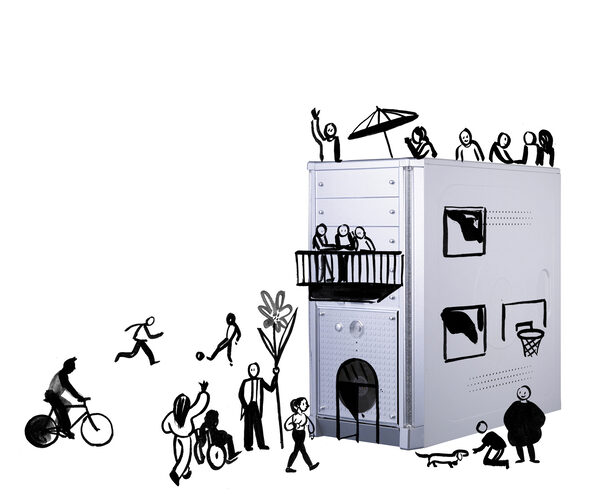

## Hallo 👋 {.ca-upper}

::: ca-team-grid

Jonas

Referent Digitale Infrastruktur Civic Data Lab

:::

::: notes
- Kurze Vorstellung
:::

## Über CorrelAid {.ca-upper .ca-about background-color="#00468a"}

::: about-grid

CorrelAid

Sascha Schürmann / Salt &amp; Content

CorrelAid hilft Non-Profits dabei, Daten kritisch und reflektiert für ihre Ziele einzusetzen.

<b>Zivilgesellschaft unterstützen</b>Pro-bono Data4Good-Projekte und Beratung für Non-Profits

<b>Datenkompetenz stärken</b>Weiterbildung für Non-Profits und Ehrenamtliche

<b>Community fördern</b>Datenanalyst*innen vernetzen sich – online und vor Ort

:::

::: notes
- CorrelAid e.V.: Netzwerk datenbegeisterter Ehrenamtlicher – aus der Zivilgesellschaft für die Zivilgesellschaft
- Civic Data Lab: Beratung und Projektbegleitung zu Daten & KI für gemeinwohlorientierte Organisationen
- CorrelCompacts: TODO
:::

## Schön, dass ihr da seid! {.ca-upper .ca-welcome}

::: ca-welcome-grid

- Ihr bekommt die **Folien** im Anschluss an den Workshop!
- Lasst uns heute im Workshop gerne beim **Du** bleiben.
- Es gibt keine „blöden“ Fragen – macht aktiv mit, teilt eure Erfahrungen und werdet eure Fragen los.
- Bitte macht **weder Fotos noch Aufzeichnungen** von anderen Teilnehmenden. Der Workshop ist ein Rahmen für vertrauensvollen Austausch.
:::

## Am Ende des Workshops {.ca-upper .ca-goals}

…könnt ihr

1. typische KI-Projekte in der Zivilgesellschaft **kennen und einordnen**
2. Werte, die in KI-Projekten beachtet werden sollten, **reflektieren**
3. Kriterien **entwickeln**, wann KI sinnvoll ist – und wann andere Lösungen besser passen

::: notes
- Ziel: selbstbewusst beantworten können, wann KI sinnvoll ist – und wann nicht
- Nicht "Wie können wir KI einsetzen?", sondern "Welches Problem haben wir?"
:::

## Inhalte {.ca-upper .ca-agenda background-image="correlaid_assets/sidebar.svg" background-size="100% 100%" background-position="left" background-repeat="no-repeat"}

<ol class="ca-toc">
<li class="active">01Ankommen & Aktivierung<small>Was kann KI angeblich? · 12 min</small></li>
<li>02KI als Werkzeug – Wann ist ein KI-Projekt sinnvoll?<small>Impuls + Übung: Probleme zu Tasks zuordnen · 25 min</small></li>
<li>03Ein KI-Projekt durchführen – Daten, Infrastruktur, Werte<small>Impuls + Übung: KI-Projekte unter der Lupe · 20 min</small></li>
<li>04Abschluss<small>Ausblick & Q&A · 3 min</small></li>
</ol>

::: notes
- Workshop: 3 Übungen, Teilnehmende sollen aktiv mitmachen
- Zeiten: 5 Einstieg · 7 Übung · 15 Impuls · 10 Übung · 10 Impuls · 10 Übung · 3 Abschluss
:::

## Die Skala

::: {style="font-size:1.8em; text-align:center; margin:0.4em 0 0.6em;"}
🧙 Mythos ⟵ 🤔 ⟶ 🦊 Fabel(haft)
:::

- 🧙 **Mythos**: klingt gut, ist aber nicht belegt – Hype, Werbeversprechen, „KI löst das schon“
- 🤔 **Kommt drauf an**: Teils, teils – oder ihr wisst es (noch) nicht
- 🦊 **Fabel(haft)**: hält, was es verspricht – konkret und nachweisbar nützlich

::: notes
- Teil der 2 min Erklärung
- Mythos: Erzählung, die Phänomene einordnet, ohne zu prüfen, ob sie stimmt
- Fabel(haft): augenzwinkernd – das, was wirklich funktioniert
- Anspielung: Mythos & Fable sind Namen von Claude-Modellen von Anthropic
:::

## Übung: Vibecheck {.center}

1. Denkt an ein **Versprechen über KI**, das ihr gehört habt – Pitch, Werbung, Förderaufruf, Kolleg:in
2. Tippt es in den **Chat** + ein Emoji von der Skala: 🧙 / 🤔 / 🦊
3. **Enter erst auf mein Los!**

::: {style="margin-top:1em; color:#374151;"}
*Beispiel: „Mit KI spart ihr 10 Stunden pro Woche“ 🧙*
:::

::: notes
- 2 min Erklärung (Skala + Ablauf), 5 min Übung
- Chat-Wasserfall: alle tippen, Enter erst auf „Los“ → alle Antworten kommen gleichzeitig
- Einige Versprechen vorlesen, v.a. solche mit unterschiedlichen Emojis; 1–2 Leute fragen, warum
- Co-Host sammelt 3–4 Versprechen für die nächste Folie
- Fokus auf Versprechen an Zivilgesellschaft: Zeiteinsparung, „kompetitiv bleiben“, Förderfähigkeit
:::

## Was wird versprochen?

- TODO: 2–3 Werbeversprechen / Pitches mit Quelle einfügen
- Typische Muster:
  - **Zeit sparen**: „mehr Zeit für das Wesentliche“
  - **Nicht abgehängt werden**: „alle nutzen schon KI“
  - **Effizienz** unter knappen Ressourcen und Förderlogiken

::: fragment
- Zwänge der Zivilgesellschaft: wenig Personal, Projektförderung, KI-Projekte haben Prestige und bekommen leichter Geld
- Folge: **Workslop** – KI-Output, der nach Arbeit aussieht, aber Arbeit verlagert
:::

[@niederhoffer2025]{.source}

::: notes
- Mit gesammelten Versprechen aus Übung abgleichen
- Workslop: KI-generierter Output, der gut aussieht, aber andere müssen nacharbeiten
:::

## Inhalte {.ca-upper .ca-agenda background-image="correlaid_assets/sidebar.svg" background-size="100% 100%" background-position="left" background-repeat="no-repeat"}

<ol class="ca-toc">
<li>01Ankommen & Aktivierung<small>Was kann KI angeblich? · 12 min</small></li>
<li class="active">02KI als Werkzeug – Wann ist ein KI-Projekt sinnvoll?<small>Impuls + Übung: Probleme zu Tasks zuordnen · 25 min</small></li>
<li>03Ein KI-Projekt durchführen – Daten, Infrastruktur, Werte<small>Impuls + Übung: KI-Projekte unter der Lupe · 20 min</small></li>
<li>04Abschluss<small>Ausblick & Q&A · 3 min</small></li>
</ol>

## Was ist KI? Intelligenz

> Intelligence is the computational part of the ability to achieve goals in the world. [...] Intelligence involves mechanisms, and **AI research has discovered how to make computers carry out some of them and not others**. [@mccarthy_what_2012]

- Intelligenz als auf ein Ziel gerichtete Fähigkeit, die unterschiedliche Komponenten umfasst (z.B. von Logik bis Erkennen von Objekten)
- Keine „Superintelligenz“, sondern einzelne Fähigkeiten

::: notes
- Intelligenz ist kein künstliches menschliches Bewusstsein
- Komponenten, auf Ziel gerichtet
:::

## KI als Oberbegriff

::: notes
- Wenn eine Technologie eine dieser Komponenten von Intelligenz abdeckt, ist sie KI
- Nicht nur generative KI (ChatGPT, Claude)
- GPT und Claude sind neuronale Sprachmodelle
:::

## Denken in Tasks

- KI-Methoden werden für **Tasks** entwickelt und mit dafür zusammengestellten Daten und Metriken evaluiert
- Beispiel-Tasks: Klassifikation, Texterkennung, Textzusammenfassung, Suche, Nutzung von Tools
- **Performance** messen: einfachste Metrik ist Accuracy (Anteil richtiger Klassifikationen)
- Neuronale Netzwerke erzielen beste Performance bei vielen Tasks bzw. ermöglichen manche erst [@lecun2015]

::: notes
- Von Wissenschaft lernen: Vorhaben in konkrete Tasks zerlegen und überlegen, wie man Performance misst
- Grundlage für Übung gleich
:::

## Von Tasks zu Prompts

- **BERT** (340 Mio. Parameter): Finetuning – Modell wird auf einen Task angepasst [@devlin2019]
- **Generative Modelle** (z.B. Claude, GPT): Parameterzahl nicht offengelegt, Schätzungen mehrere Billionen
  - **Zero-/Few-Shot Prompting** und In-Context Learning: keine Veränderung der Parameter [@brown2020]
- Darauf aufbauend:
  - **RAG** (Retrieval-Augmented Generation): Modell sucht erst in eigenen Dokumenten, antwortet dann
  - **Agents**: Modell nutzt Tools (Suche, Code, Dateien) und plant Schritte selbst

::: fragment
- **Power der Prompts** – aber: Probleme trotzdem in Tasks zerlegen und Performance prüfen
:::

::: notes
- Hin zu Universalwerkzeugen: ein Prompt statt eigenes Modell
- Performance nicht als gegeben ansehen; je größer das Modell, desto mehr externalisierte Kosten
:::

## Bestehen die Voraussetzungen? KI als Mythos

- **Techno-Solutionismus**: KI wird als Lösung vorgeschlagen, aber das eigentliche Problem nicht gelöst (Chatbot gegen Einsamkeit) [@morozov2013]
- **Systemisches Problem?** Fehlende Ressourcen lassen sich nicht wegautomatisieren
- **Prozessoptimierung** statt Agentic AI – bessere Informationsarchitektur statt eigener Chatbot
- Ehrenamtliche würden KI lieber für Verwaltung als für Social Media einsetzen [@cdl_ki_ehrenamt]
- Prompt Engineering als Pseudowissenschaft: „You are a senior air traffic controller…“ [@zheng2024]

::: notes
- Aus CDL-Beratungen: Anfrage Chatbot -> oft stellt sich heraus, dass Website-Struktur das Problem ist
- Umfrage mit digital verein(t)
- Rollen-Prompts verbessern Performance nicht verlässlich
:::

## Typische KI-Projekte in der Zivilgesellschaft

:::: {.columns}

::: {.column width="50%"}
**„Traditionellere“ Tasks**

- **Klassifikation**
  - AWO Demokratieförderquote: Förderprogramme klassifizieren [@cdl_demokratiefoerderquote]
  - AfD-Gutachten: Äußerungen vorfiltern [@verfassungsblog2026]
- **Handschrifterkennung**: genialsozial – handschriftliche Formulare digitalisieren
:::

::: {.column width="50%"}
**Informationszugang**

- **Chatbots**
- **RAG / semantische Suche**: Schule ein Gesicht geben – Infos mit eigenen Worten finden

**Agentic**

- **Coding** mit Agents: produktiver? Erfahrene Entwickler:innen waren mit KI langsamer [@becker2025]
:::

::::

::: notes
- Demokratieförderquote: nur bei einfachen Entscheidungen auf KI verlassen, schwierige Fälle Menschen überlassen
- Handwriting Recognition als bewusst akzeptierter temporärer Tech-Fix; Untersuchung, wie hoch Performance getrieben werden kann
- Coding: aus eigener Erfahrung erzählen
:::

## Kriterien: Wann ist KI sinnvoll?

- Lässt sich das Problem in einen **klaren Task** zerlegen?
- Kann man **Performance messen** – und reicht sie? Was kosten Fehler?
- Gibt es **einfachere Lösungen** (Prozess, Struktur, klassische Software)?
- Ist es ein **systemisches Problem**, das Technik nicht löst?
- Sind **Daten, Fähigkeiten und Infrastruktur** vorhanden?
- Stehen Nutzen und **externalisierte Kosten** in einem vertretbaren Verhältnis?

::: notes
- Kriterienliste als Arbeitsgrundlage für die folgenden Übungen
- Teilnehmende sollen sie in Übung 3 ergänzen
:::

## Übung: Probleme zu Tasks zuordnen {.ca-dense}

*Fiktionale Beispiele – welcher Task? Wie würdet ihr Performance beurteilen? Wäre KI überhaupt nötig?*

1. Ein Sportverein bekommt 200 E-Mails pro Woche und will sie an die richtige Person weiterleiten.
2. Ratsuchende sollen die umfangreichen FAQ einer Beratungsstelle schneller durchsuchen können.
3. Ein Archiv hat 3.000 handschriftliche Mitgliedsanträge aus den 1980ern.
4. Eine Initiative will „mehr Reichweite“ auf Social Media.
5. Denkt euch ein eigenes Problem aus!

**Tasks:** ① Klassifikation · ② Texterkennung · ③ Semantische Suche / RAG · ④ Textgenerierung · ⑤ Agent · ⑥ *kein KI-Task*

*Tippt die Nummer in den Chat – Enter erst auf mein Los!*

::: notes
- 2 min Erklärung, 8 min Plenum
- Pro Problem Chat-Wasserfall: Problem vorlesen, alle tippen die Task-Nummer, Enter auf „Los“ (~2 min pro Problem)
- Bei abweichenden Nummern 1–2 Leute bitten, das Mikro anzumachen
- Lösung (Fragment) erst nach der Diskussion einblenden; Problem 5 nur bei übriger Zeit
- Mögliche Lösungen: 1 Klassifikation (oder: klarere Kontaktadressen), 2 semantische Suche / RAG (oder: bessere FAQ-Struktur), 3 Handschrifterkennung, 4 kein klarer Task -> Problem schärfen
- Performance: Wie viele Mails richtig zugeordnet? Was passiert bei Fehlern?
:::

## Auflösung: Probleme zu Tasks

| Problem | Task | Oder ohne KI? |
|---|---|---|
| 1 · 200 E-Mails weiterleiten | ① Klassifikation | klarere Kontaktadressen, Formular |
| 2 · FAQ durchsuchen | ③ Semantische Suche / RAG | bessere FAQ-Struktur |
| 3 · Handschriftliche Anträge | ② Texterkennung | – |
| 4 · „Mehr Reichweite“ | ⑥ kein klarer Task | Problem erst schärfen |

::: notes
- Erst nach der Diskussion zeigen
- Betonen: Spalte „Oder ohne KI?“ – oft die bessere Lösung
:::

## Inhalte {.ca-upper .ca-agenda background-image="correlaid_assets/sidebar.svg" background-size="100% 100%" background-position="left" background-repeat="no-repeat"}

<ol class="ca-toc">
<li>01Ankommen & Aktivierung<small>Was kann KI angeblich? · 12 min</small></li>
<li>02KI als Werkzeug – Wann ist ein KI-Projekt sinnvoll?<small>Impuls + Übung: Probleme zu Tasks zuordnen · 25 min</small></li>
<li class="active">03Ein KI-Projekt durchführen – Daten, Infrastruktur, Werte<small>Impuls + Übung: KI-Projekte unter der Lupe · 20 min</small></li>
<li>04Abschluss<small>Ausblick & Q&A · 3 min</small></li>
</ol>

## Wie hole ich die Potentiale aus KI raus?

- **Interfaces**: Chat-Oberfläche, API, eingebaute KI in bestehenden Tools, lokale Modelle
- **Daten sind die Grundlage**:
  - **Datentypen**: Tabellen, Texte, Bilder, Audio
  - **Texte als Daten**: KI macht unstrukturierte Texte auswertbar
  - **Metadaten**: Daten über Daten – wer, wann, was, in welchem Format?
  - **Semantische Daten**: Bedeutung explizit machen (Kategorien, Verknüpfungen)
- **Kontextmanagement**: Das Modell weiß nur, was im Prompt / Kontext steht

::: notes
- Ohne geordnete Daten bringt auch das beste Modell wenig
- RAG und Agents funktionieren nur so gut wie die Dokumente, die sie finden
- Kontext: welche Dokumente, welche Anweisungen, was ist zu viel
:::

## Welche Werte müssen beachtet werden? {.ca-dense}

:::: {.columns}

::: {.column width="50%"}
- **Datenschutz**: Personenbezogene Daten? Wo werden sie verarbeitet?
- **Bias & Diskriminierung**: ML reproduziert gesellschaftliche Ungleichheiten [@buolamwini2018]
- **Copyright**: Trainingsdaten und Output
- **Ressourcenverbrauch**: Rechenzentren 2030 mehr Strom als ganz Japan [@iea2025]
:::

::: {.column width="50%"}
- **Big Tech**: Machtkonzentration, politische Agenda [@kak2023]
- **Ausbeutung**: Klickarbeit beim Datenlabeling [@perrigo2023]
- **Cognitive Outsourcing**: KI ersetzt Denkprozesse [@jose2025]
:::

::::

::: fragment
**Abwägung vs. Prinzipien**: im Einzelfall abwägen – oder klare rote Linien ziehen?
:::

::: notes
- Streitthemen, keine vollständige Liste
- Big Tech: Silicon Valley unterstützt größtenteils Trump; Peter Thiel (Palantir) sieht Regulierung als "Antichrist"
- KI ist durch Umstände ihrer Herstellung nicht nur Werkzeug, sondern politisch und hat externalisierte Kosten [@keymolen2026]
- Boykott ist begründbar; individuelle ethische Entscheidung
:::

## Big Tech: Wer entwickelt KI?

{style="height:420px; display:block; margin:auto;"}

[@rozen2026]{.source}

::: notes
- Optional, falls Zeit
- Fast der komplette "Grey Tribe" (Palantir, Anthropic, OpenAI, Microsoft, Google, Meta, Musk) mit Trump
- Thiel: Regulierung, Multilateralismus, Institutionen = "Antichrist"
- Daraus: Regulierung und demokratische Institutionen verteidigen
:::

## Übung: KI-Projekte unter der Lupe {.ca-dense}

*Breakout-Räume A–D, je ein fiktionales Projekt · Notizen im Pad: PAD-LINK · Danach im Chat: 🟢 / 🟡 / 🔴 + ein Satz*

:::: {.columns}

::: {.column width="48%"}
**Projekte**

- **A** Tafel: Spendeneingänge automatisch kategorisieren
- **B** Mieterverein: semantische Suche über 15 Jahre Rundbriefe
- **C** Beratungsstelle: Chatbot für Erstfragen
- **D** Verein: Agent bereitet Förderanträge vor
:::

::: {.column width="52%"}
**Fragen**

- Welcher Task? Wie messen wir, ob es funktioniert?
- Welche Daten, Fähigkeiten, Infrastruktur braucht es?
- Geht es um **personenbezogene Daten**?
- Welche Werte sind berührt? Was passiert bei Fehlern?
- **Sinnvoll – ja, nein, unter welchen Bedingungen?**
:::

::::

::: notes
- 2 min Aufteilung, 8 min Breakout-Räume, Rückmeldung im Chat
- Pad-Link VOR dem Öffnen der Räume im Hauptchat posten – in Breakout-Räumen ist der Hauptchat nicht sichtbar
- Co-Host: Räume A–D öffnen (automatisch zuweisen), bei 2 min Restzeit Broadcast „Einigt euch auf Ampel + einen Satz“
- Rückmeldung: jede Gruppe postet Ampel + Satz im Chat, vorlesen statt langer Runde
- Ziel: Kriterien aus Impuls anwenden und ergänzen
:::

## Inhalte {.ca-upper .ca-agenda background-image="correlaid_assets/sidebar.svg" background-size="100% 100%" background-position="left" background-repeat="no-repeat"}

<ol class="ca-toc">
<li>01Ankommen & Aktivierung<small>Was kann KI angeblich? · 12 min</small></li>
<li>02KI als Werkzeug – Wann ist ein KI-Projekt sinnvoll?<small>Impuls + Übung: Probleme zu Tasks zuordnen · 25 min</small></li>
<li>03Ein KI-Projekt durchführen – Daten, Infrastruktur, Werte<small>Impuls + Übung: KI-Projekte unter der Lupe · 20 min</small></li>
<li class="active">04Abschluss<small>Ausblick & Q&A · 3 min</small></li>
</ol>

## Code of Conduct Demokratische KI {.ca-coc}

::: coc-grid
<figure><figcaption>Abwägung der Nutzung</figcaption></figure>
<figure><figcaption>Menschenzentrierung</figcaption></figure>
<figure><figcaption>Transparenz</figcaption></figure>
<figure><figcaption>Teilhabe und Partizipation</figcaption></figure>
<figure><figcaption>Diskriminierungskritische Haltung</figcaption></figure>
<figure><figcaption>Verantwortung und Verantwortlichkeit</figcaption></figure>
<figure><figcaption>Kompetenzen</figcaption></figure>
<figure><figcaption>Ökologische Nachhaltigkeit</figcaption></figure>
:::

[demokratische-ki.de · @d64_coc; @d64_2025]{.source}

::: notes
- Code of Conduct von CorrelAid mitentwickelt
- 8 Grundprinzipien, konkrete Handlungsempfehlungen für gemeinwohlorientierte Organisationen
:::

## Mitnehmen

- Weniger *„Wie können wir KI einsetzen?“*, mehr *„Welches Problem haben wir (wirklich) – und ist KI dafür die beste Lösung?“*
- Mitdenken: *„Wozu – und zu welchem Preis?“*
- **DD KI** ab 25.11. – TODO Link / Beschreibung

::: notes
- Werbung für DD KI
- Zeit für Fragen
:::

# Zeit für Fragen

## Quellen {.scrollable}

::: {#refs}
:::
