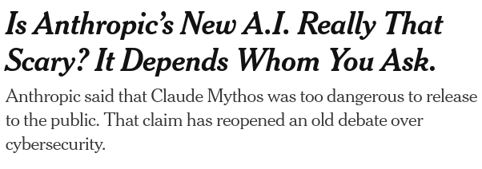
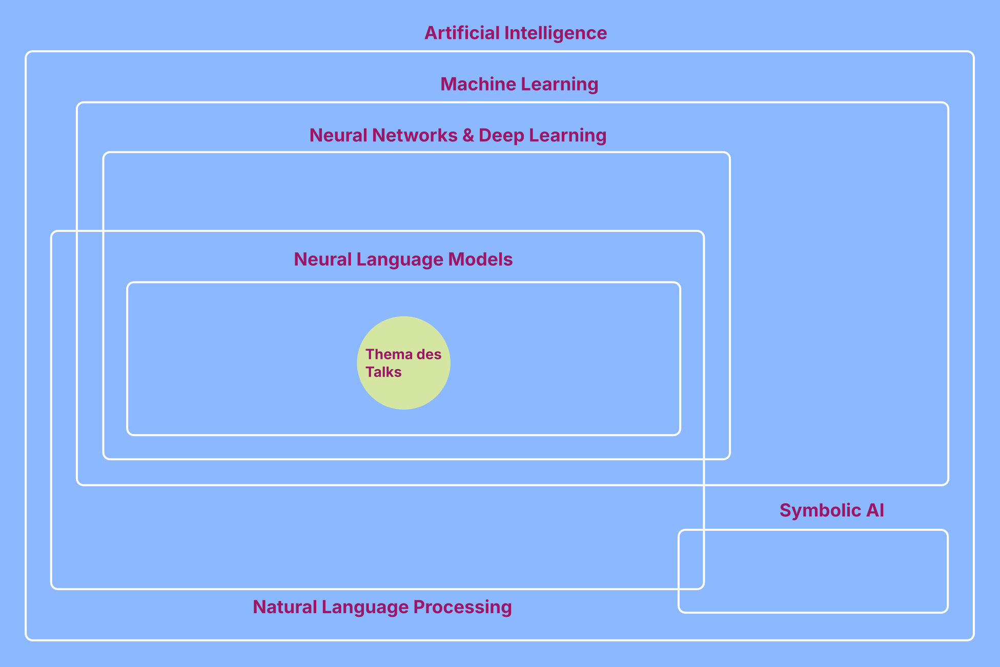

## Hallo 👋 {.ca-upper}

::: ca-team-grid
<div class="ca-person"><div class="ring"></div><div class="name">Jonas</div><div class="role">Referent für Digitale Infrastruktur bei CorrelAid</div></div>
:::

::: notes
- Kurze Vorstellung
:::

## Über CorrelAid {.ca-upper .ca-about}

::: about-grid
<div class="photos">
<div class="ph-wrap"><span class="credit">CorrelAid</span></div>
<div class="ph-wrap"><span class="credit">Sascha Schürmann / Salt &amp; Content</span></div>
</div>
<div class="about-text">
<p class="lead">CorrelAid hilft Non-Profits dabei, Daten kritisch und reflektiert für ihre Ziele einzusetzen.</p>
<div class="pillar"><b>Zivilgesellschaft unterstützen</b>Pro-bono Data4Good-Projekte und Beratung für Non-Profits</div>
<div class="pillar"><b>Datenkompetenz stärken</b>Weiterbildung für Non-Profits und Ehrenamtliche</div>
<div class="pillar"><b>Community fördern</b>Datenanalyst*innen vernetzen sich online und vor Ort</div>
</div>
:::

::: notes
- CorrelAid e.V.: Netzwerk datenbegeisterter Ehrenamtlicher aus der Zivilgesellschaft für die Zivilgesellschaft
- Civic Data Lab: Beratung und Projektbegleitung zu Daten & KI für gemeinwohlorientierte Organisationen
- CorrelCompacts: TODO
:::

## Schön, dass ihr da seid! {.ca-upper .ca-welcome}

::: ca-welcome-grid


- Die **Folien** findet ihr hier: [correlaid.github.io/power_der_prompts_d3](https://correlaid.github.io/power_der_prompts_d3/#/title-slide)
- Lasst uns heute im Workshop gerne beim **Du** bleiben.
- Es gibt keine „blöden“ Fragen. Macht aktiv mit, teilt eure Erfahrungen und werdet eure Fragen los.
- Bitte macht **keine Screenshots oder Mitschnitte** von anderen Teilnehmenden. Der Workshop ist ein Rahmen für vertrauensvollen Austausch.
:::

::: notes
- Achtung: Über den Folien-Link kann man die Lösungen (z.B. „Mögliche Zuordnungen“) vorab sehen. Link ggf. erst nach dem Workshop freischalten
:::

## Am Ende des Workshops {.ca-upper .ca-goals}

…könnt ihr

1. typische KI-Projekte in der Zivilgesellschaft **kennen und einordnen**
2. die Voraussetzungen für KI-Projekte (Daten, Fähigkeiten, Infrastruktur) **erkennen**
3. Werte, die in KI-Projekten beachtet werden sollten, **reflektieren**
4. Kriterien **entwickeln**, wann KI sinnvoll ist und wann andere Lösungen besser passen

::: notes
- Titel-Spannung offen ansprechen: „Die Power der Prompts klingt nach Hype. Das schauen wir uns heute an.“
- Ziel: selbstbewusst beantworten können, wann KI sinnvoll ist und wann nicht
- Leitfrage: „Welches Problem haben wir?“ statt „Wie können wir KI einsetzen?“
:::

## Inhalte {.ca-upper .ca-agenda}

<ol class="ca-toc">
<li class="active"><span class="num">01</span><span class="label">Ankommen & Aktivierung<small>Was kann KI angeblich? · 7 min</small></span></li>
<li><span class="num">02</span><span class="label">KI als Werkzeug: Wann ist ein KI-Projekt sinnvoll?<small>Impuls + Mini-Evaluation + Übung: Probleme zu Tasks zuordnen · 29 min</small></span></li>
<li><span class="num">03</span><span class="label">Ein KI-Projekt durchführen: Daten, Infrastruktur, Werte<small>Impuls + Übung: KI-Projekte unter der Lupe · 19 min</small></span></li>
<li><span class="num">04</span><span class="label">Abschluss<small>Ausblick & Q&A · 5 min</small></span></li>
</ol>

::: notes
- Workshop: 3 Übungen, Teilnehmende sollen aktiv mitmachen
- Zeiten: 7 Block 1 (2 Begrüßung bis Inhalte · 1 Skala · 3 Vibecheck · 1 Versprechen) · 11 Konzepte (Intelligenz bis Messen) · 9 Mini-Evaluation (inkl. Umfrage) · 1 Kriterien Teil 1 · 8 Übung 2 · 7 Daten & Werte · 12 Übung 3 · 5 Abschluss = 60
- Kein Puffer eingeplant! Kürzen in dieser Reihenfolge: 1. Big-Tech-Folie · 2. Bonus-Problem Übung 2 · 3. Projekttabelle nur zeigen, nicht besprechen · 4. Folie „Zwei Prompts“ überspringen und den Unterschied mündlich nennen · 5. Intelligenz-Folie überspringen, direkt zum Oberbegriff · 6. „Was oft vergessen wird“ nur kurz anreißen
- Ziel: 3–5 min Puffer für Breakout-Technik und Fragen
- Wenn nach „Oberbegriff“ schon 4 min von Block 2 vorbei: Projekttabelle nur zeigen, nicht besprechen („Beispiele zum Nachlesen“)
:::


## Die Skala

::: {style="font-size:1.8em; text-align:center; margin:0.4em 0 0.6em;"}
🧙 Mythos ⟵ 🤔 ⟶ 🦊 Fable(haft)
:::

- 🧙 **Mythos**: klingt gut, ist aber nicht belegt (Hype, Werbeversprechen, „KI löst das schon“)
- 🤔 **Kommt drauf an**: teils, teils, oder ihr wisst es (noch) nicht
- 🦊 **Fable(haft)**: hält, was es verspricht, und ist nachweisbar nützlich

::: notes
- Skala in 1 min erklären
- Mythos: Erzählung, die Phänomene einordnet, ohne zu prüfen, ob sie stimmt
- Wortspiel laut aussprechen: gemeint ist „fabelhaft“ (= super), nicht „Fabel“ (die ist ja auch erfunden)
:::

## Die Skala

::: {style="font-size:1.8em; text-align:center; margin:0.4em 0 0.6em;"}
🧙 Mythos ⟵ 🤔 ⟶ 🦊 Fable(haft)
:::

::: {.skala-pics .skala-pics-wide}
{.pic-light}

{.pic-dark}
:::

[@nyt2026mythos · Screenshot: Claude-Modellauswahl, November 2026]{.source}

::: notes
- Ein Satz zur Anspielung: „Mythos“ und „Fable“ heißen auch Modelle der Firma Anthropic (Claude). KI-Firmen benennen ihre Produkte selbst nach Erzählungen
- Im April 2026 hielt Anthropic „Mythos Preview“ für zu gefährlich zur Veröffentlichung, seit Juni 2026 sind Mythos-Modelle verfügbar. Fable ist dasselbe Modell mit zusätzlichen Schutzmaßnahmen. Die Namen sind also Marketing
- „Zu gefährlich“ ist selbst ein Versprechen, das man auf die Skala legen kann
:::

## Übung: Vibecheck {.center}

1. Denkt an ein **Versprechen über KI**, das ihr gehört habt (Pitch, Werbung, Förderaufruf, Kolleg*in)
2. Tippt es in den **Chat** + ein Emoji von der Skala: 🧙 / 🤔 / 🦊
3. **Enter erst auf mein Los!**

::: {style="margin-top:1em; color:#374151;"}
*Beispiel: „Mit KI spart ihr 10 Stunden pro Woche“ 🧙*
:::

::: notes
- 3 min Übung (Skala ist schon erklärt)
- Chat-Wasserfall: alle tippen, Enter erst auf „Los“, dann kommen alle Antworten gleichzeitig
- Nur zwei Versprechen vorlesen, möglichst mit unterschiedlichen Emojis; eine Person fragen, warum
- Diese zwei Versprechen auf der nächsten Folie aufgreifen (Chat bleibt stehen)
- Fokus auf Versprechen an Zivilgesellschaft: Zeiteinsparung, „kompetitiv bleiben“, Förderfähigkeit
:::

## Was wird versprochen?

- Eure Versprechen aus dem Chat: …
- Typische Muster: **Zeit sparen** · **nicht abgehängt werden** · **Effizienz** unter Förderlogiken

::: fragment
- Zwänge der Zivilgesellschaft: wenig Personal, Projektförderung. Aus unseren Beratungen wissen wir: KI-Projekte haben Prestige und bekommen leichter Geld
- Folgen:
  - **Workslop**: KI-Output, der nach Arbeit aussieht, die Arbeit aber auf andere verlagert (Umfrage unter US-Büroangestellten)
  - Projekte, in denen KI unnötig ist
:::

[@niederhoffer2025]{.source}

::: notes
- Live-Folie: die zwei Versprechen aus dem Chat („Vorhin hat jemand geschrieben …“) den Mustern zuordnen
- Optional: ein verifiziertes echtes Beispiel ergänzen (z.B. aus einem Förderaufruf)
- Workslop: KI-generierter Output, der gut aussieht, bei dem andere aber nacharbeiten müssen
:::

## Inhalte {.ca-upper .ca-agenda}

<ol class="ca-toc">
<li><span class="num">01</span><span class="label">Ankommen & Aktivierung<small>Was kann KI angeblich? · 7 min</small></span></li>
<li class="active"><span class="num">02</span><span class="label">KI als Werkzeug: Wann ist ein KI-Projekt sinnvoll?<small>Impuls + Mini-Evaluation + Übung: Probleme zu Tasks zuordnen · 29 min</small></span></li>
<li><span class="num">03</span><span class="label">Ein KI-Projekt durchführen: Daten, Infrastruktur, Werte<small>Impuls + Übung: KI-Projekte unter der Lupe · 19 min</small></span></li>
<li><span class="num">04</span><span class="label">Abschluss<small>Ausblick & Q&A · 5 min</small></span></li>
</ol>

## Was ist KI? Intelligenz

> Intelligenz ist der rechnerische Teil der Fähigkeit, Ziele in der Welt zu erreichen. […] Intelligenz umfasst Mechanismen; die KI-Forschung hat herausgefunden, wie Computer **manche davon ausführen können, andere nicht**.

KI ist also ein **Bündel von Fähigkeiten**: einordnen, lesen, wiederfinden, formulieren, vorausschauen, planen … Manche davon kann KI gut, andere kaum.

[@mccarthy_what_2012, eigene Übersetzung]{.source}

::: notes
- Original: „Intelligence is the computational part of the ability to achieve goals in the world. […] Intelligence involves mechanisms, and AI research has discovered how to make computers carry out some of them and not others.“
- Intelligenz meint hier kein künstliches menschliches Bewusstsein, nur ein Bündel von Fähigkeiten, die auf ein Ziel gerichtet sind
- Beispiel für „manche ja, andere nicht“ (Moravec-Paradox): Ein Schachcomputer schlägt 1997 den Weltmeister. Roboter, die zuverlässig und günstig in einer fremden Küche aufräumen, gibt es bis heute nicht. Was für uns schwer ist, kann für Maschinen leicht sein, und umgekehrt
:::

## Was ist KI? Ein Oberbegriff

{fig-align="center" style="max-height:560px;" fig-alt="Verschachtelte Kästen: Künstliche Intelligenz umfasst Machine Learning, darin neuronale Netze und Deep Learning, darin neuronale Sprachmodelle. Daneben symbolische KI (Regeln). Natural Language Processing überschneidet sich mit beiden."}

::: notes
- KI als Oberbegriff: Wenn eine Technologie eine dieser Fähigkeiten abdeckt, ist sie KI
- KI umfasst mehr als generative KI (ChatGPT, Claude). GPT und Claude sind neuronale Sprachmodelle
- Breite Definition ist wissenschaftlich üblich. Der AI Act grenzt aber einfache regelbasierte Software aus. Für die Art.-4-Pflicht zählt die AI-Act-Definition
- Bild zeigt Methoden, nicht Fähigkeiten. Symbolic AI = Regeln, kommt gleich als „Bauweise“ wieder
- Überleitung: „Diese Fähigkeiten sind noch zu vage, um damit zu arbeiten. Dafür braucht es Tasks.“
:::

## Von Fähigkeiten zu Tasks {.ca-dense .ca-table .ca-tight}

Ein **Task** legt fest: Was geht rein? Was soll rauskommen? Woran messen wir, ob es stimmt?

| Task | Beispiel: Eingabe → Ausgabe | Wie messen? |
|---|---|---|
| ① Klassifikation | E-Mail → zuständige Person | Anteil richtig, Fehlalarme vs. Übersehene |
| ② Informationsextraktion | Rechnung → Betrag, Datum, Absender | Anteil korrekter Felder |
| ③ Texterkennung / Spracherkennung | Formular oder Interview-Audio → Text | Anteil falscher Wörter |
| ④ Suche / Fragen beantworten | Frage → passende Dokumente | Richtiges Dokument unter den Top 5? |
| ⑤ Vereinfachen / Umformulieren | Behördenbrief → Leichte Sprache | Prüfung durch Zielgruppe |
| ⑥ Gruppieren (Clustering) | 2.000 Freitextantworten → Themen | Keine richtige Antwort, daher Plausibilität prüfen |
| ⑦ Dubletten erkennen | Spendendatenbank → doppelte Einträge | Anteil gefundener Dubletten |
| ⑧ Vorhersage / Anomalie | Einsatzdaten → Bedarf morgen | Abweichung, Fehlalarme vs. Übersehene |

::: {.fragment style="font-size:0.8em; margin-top:0.4em;"}
**Bauweise:** Regeln · klassisches ML · kleines feinjustiertes Modell · großes Modell + Prompt · RAG · Agent. Für denselben Task gibt es verschiedene Bauweisen. Welche passt, zeigt die Messung. Regeln zählen im weiten Sinn als KI, unter dem AI Act meist nicht.
:::

::: {.fragment style="font-size:0.7em; margin-top:0.3em; color:#4b5563;"}
**Klassisches ML:** lernt aus gelabelten Beispielen · **Feinjustiert:** vorhandenes Modell mit eigenen Beispielen nachtrainiert · **RAG:** Modell sucht erst in euren Dokumenten, dann antwortet es · **Agent:** Modell plant Schritte selbst und nutzt Tools
:::

::: notes
- Zentrale Folie des Workshops: vage Fähigkeit („Sprache verstehen“) vs. klarer Task („Mails einer Person zuordnen“)
- Die Nummern ①–⑧ kommen in Übung 2 wieder
- Von der Wissenschaft lernen: KI-Methoden werden für Tasks entwickelt und mit eigens zusammengestellten Daten und Metriken verglichen
- Agent ist eine Bauweise, kein Task. Die Ausgabe ist eine Folge von Handlungen und deshalb viel schwerer zu messen. Merken für Übung 3 (Projekt D)
- Wie man Performance konkret misst, kommt nach der Prompting-Folie
- Neuronale Netze sind seit etwa 2012 bei vielen dieser Tasks führend, vor allem bei Bild, Sprache und Text [@lecun2015]. Bei Tabellendaten sind baumbasierte Verfahren oft besser [@grinsztajn2022]
- Regeln vs. AI Act: Brücke zur Art.-4-Folie in Block 3
- RAG und Agent werden in Übung 3 (Projekte B und D) gebraucht
- Früher: ein Modell pro Task, extra dafür trainiert (z.B. BERT) [@devlin2019]; heute oft: ein großes generatives Modell + Prompt, das Modell wird nicht verändert [@brown2020]
- Nur bei Nachfrage: BERT 340 Mio. Parameter, Finetuning; große generative Modelle legen Parameterzahl nicht offen (Schätzungen: Billionen); Zero-/Few-Shot Prompting, In-Context Learning
- Performance nicht als gegeben ansehen; je größer das Modell, desto mehr externalisierte Kosten
:::

## Typische KI-Projekte nach Task {.ca-dense .ca-table}

| Task | Projekt | Stand |
|---|---|---|
| **① Klassifikation** | [In safe hands](https://correlaid.org/projekte/projektdatenbank/2023-10-ISH): Interviewantworten kategorisieren | in Weiterentwicklung |
| | [AWO](https://www.civic-coding.de/ueber-civic-coding/projektlandkarte/projekt/demokratiefoerder-rechner/93): Förderprogramme einordnen | abgeschlossen |
| **③ Texterkennung** | [genialsozial](https://www.saechsische-jugendstiftung.de/programme-projekte/genialsozial): Handschrifterkennung für Formulare | wird geprüft |
| **④ Suche / Fragen beantworten** | [Schule ein Gesicht geben](https://www.civic-coding.de/ueber-civic-coding/projektlandkarte/projekt/datengestuetzte-zugaenge-zur-wissensdatenbank-von-schule-ein-gesicht-geben-ev/84): Wissensdatenbank | unbekannt |
| | [Jugendhilfe.ai](https://jugendhilfe.ai/): Suchmaschine fürs Sozialrecht | in Weiterentwicklung |
| **⑤ Vereinfachen** | [Fair Text](https://fair-text.com/), [ErLeSen](https://www.civic-coding.de/ueber-civic-coding/projektlandkarte/projekt/erstellung-und-analyse-leichter-sprache-durch-kuenstliche-intelligenz-erlesen/3): Leichte Sprache | in Betrieb |
| **⑧ Vorhersage / Anomalie** | [DRK](https://publish.obsidian.md/datenprojekte-civic-data/Projekt/Disposition+von+Rettungsmitteln): Rettungswagen vorausschauend verlegen | im Testbetrieb |
| | [BeeObserver](https://correlaid.org/projekte/projektdatenbank/2019-10-BEE): Anomalien im Bienenstock erkennen | in Betrieb |

[Stand laut Katalog, Selbstauskunft · @cdl_projektkatalog]{.source}

::: notes
- Gleiche Handvoll Tasks hinter sehr unterschiedlichen Themen
- Rechte Spalte: Vieles ist Idee, Prototyp oder Selbstauskunft. Auch hier gilt die Skala vom Anfang
- Fehlalarme vs. Übersehene = Precision/Recall in einfachen Worten
- DRK sind eigentlich zwei Schritte: Bedarf vorhersagen + Standorte optimieren
- ② und ⑥ bewusst nicht auf der Folie. Echte Beispiele kommen in Übung 2 als Auflösung (Kassenführung EVIM, Full Fact). Für ⑦ kein Katalogbeispiel
- Demokratieförderquote: nur bei einfachen Entscheidungen auf KI verlassen, schwierige Fälle Menschen überlassen
- Weiteres Klassifikations-Beispiel: AfD-Gutachten, Äußerungen vorfiltern [@verfassungsblog2026]
- Weitere Beispiele aus dem Katalog: KIA (Anfrage klassifizieren, dann Hinweise für Berater*innen generieren), Das steht dir zu (Rechner als Regelwerk + RAG-Chat)
- KAIMo (Kinderschutz, eingestellt) als Beispiel für einen schwer messbaren Task. Projektseite vorher lesen
- Katalog: Status-Angaben teils Selbstauskunft
- AWO Demokratieförder-Rechner [@cdl_demokratiefoerderquote]
- genialsozial: Handschrift-Digitalisierung nur geprüft, Hauptarbeit ist das digitale Formular. Handschrifterkennung wäre ein bewusst akzeptierter, temporärer Tech-Fix
- Agents: Kein Katalog-Projekt ist agentisch. Stattdessen von eigener Coding-Erfahrung erzählen. Kleine Studie: erfahrene Entwickler*innen waren mit KI langsamer, nicht verallgemeinern [@becker2025]
:::

## Was Prompts können {.ca-dense}

- **Task genau beschreiben**, Kategorien definieren
- **3–5 gelabelte Beispiele** mitgeben, aber nicht aus euren Testfällen
- **Ausgabeformat** festlegen (z.B. nur die Kategorie)
- ⚠️ Kleine Änderungen am Prompt oder ein Modell-Update können die Ergebnisse verschieben, also **immer neu messen** [@sclar2024]
- ✗ Rollen („Du bist Expert*in …“) helfen nicht verlässlich [@zheng2024]

::: {.fragment style="font-size:0.85em; margin-top:0.6em;"}
Viele Tasks lassen sich heute mit einem großen Modell + **Prompt** lösen, aber nicht immer am besten. Bei Tabellendaten gewinnen oft klassische Verfahren, bei Textklassifikation oft kleine, feinjustierte Modelle [@grinsztajn2022; @bucher2024].
:::

::: notes
- Fragment greift den Titel auf: Prompts sind mächtig, aber nicht automatisch die beste Bauweise
- Beispiele im Prompt = Few-Shot Prompting
- Erst ein festes Ausgabeformat macht Ergebnisse messbar
- Beispiele nicht aus den Testfällen nehmen, sonst prüft man nur, ob das Modell abschreiben kann
- Überleitung: „Woher wisst ihr, ob der Prompt gut ist? Messen.“
:::

## Performance messen {.ca-dense}

1. **100 echte Fälle** sammeln, seltene und kritische Fälle gezielt mit aufnehmen
2. **Zu zweit labeln**: Wo seid ihr euch uneinig? Dort sind die Kategorien unklar
3. **Vergleichen** mit einer einfachen Lösung (Stichwortregel, „alles ans Büro“) und dem heutigen Prozess
4. **Prompt an anderen Fällen basteln** als an denen, mit denen ihr messt
5. **Fehler anschauen**: Welche Fälle gehen schief, und wen trifft das?

::: fragment
**Faustregel:** Bei 100 Fällen sind 88 % und 92 % kein belastbarer Unterschied.
:::

::: notes
- Wichtigste praktische Botschaft: Performance prüfen geht auch ohne Data-Science-Team
- Vor der Einführung messen, nicht danach
- Regelmäßig wiederholen, Modelle ändern sich mit Updates
- Punkt 4: sonst misst man nur, wie gut man den Prompt an genau diese Fälle angepasst hat
- Faustregel: Unsicherheit bei n = 100 und rund 90 % Trefferquote etwa ± 6 Prozentpunkte, bei niedrigerer Trefferquote mehr
- Für Rückfragen: Zwei Prompts an denselben Fällen vergleichen und die Fälle anschauen, bei denen sie sich unterscheiden. Das sagt mehr als zwei Prozentzahlen
- Fehlerkosten: Eine falsch sortierte Mail ist ärgerlich, eine falsche Auskunft in der Beratung kann schaden
:::

## Mini-Evaluation: Wohin gehört die Mail? {.ca-dense .ca-mails}

Sportverein, vier Kategorien: **A** Mitgliedschaft · **B** Training & Termine · **C** Spenden & Sponsoring · **D** Sonstiges

:::: {.columns}

::: {.column width="50%"}
1. „Ich möchte zum Jahresende kündigen.“
2. „Fällt das Training am Donnerstag wegen der Hallensanierung aus?“
3. „Unsere Bäckerei würde gern Trikots für die Jugend sponsern.“
4. „Meine Tochter möchte mitmachen. Gibt es ein Probetraining?“
5. „Kann ich meinen Beitrag dieses Jahr als Spende absetzen?“
:::

::: {.column width="50%"}
6. „Wo finde ich das Protokoll der letzten Mitgliederversammlung?“
7. „Ich habe meine Trinkflasche in der Halle vergessen.“
8. „Meine Bankverbindung hat sich geändert.“
9. „Wir möchten nach dem Turnier den Erlös spenden. Zählt das auch als Mitgliedsbeitrag für unser Team?“
10. „Darf ich als Nichtmitglied beim Sommerfest helfen?“
:::

::::

*Gleich kommt eine Umfrage zu den Mails 4, 5, 6, 9 und 10: Welche Kategorie?*

::: notes
- 9 min insgesamt: 1 min lesen, 1 min Umfrage starten, 2 min abstimmen, 3 min Prompts + Auswertung, 2 min Debrief
- Zoom-Umfrage startet der Tech-Support auf Stichwort: 5 Fragen (Mail 4, 5, 6, 9, 10), je A–D, Ergebnisse teilen
- Fallback ohne Umfrage: nur die 5 Buchstaben in den Chat (Wasserfall), grob überfliegen
- Bewusst mehrdeutig: 4 (A oder B), 5 (A oder C), 6 (A oder D), 9 (A oder C), 10 (A, B oder D)
- Eindeutig: 1 A · 2 B · 3 C · 7 D · 8 A
- „Das gibt es übrigens“: innatura gGmbH überlegt, Routineanfragen im Bestell-Postfach per KI zu erkennen (Pitch/Idee, kein laufendes System) [@cdl_projektkatalog]
:::

## Mini-Evaluation: Zwei Prompts, ein Modell {.ca-dense .ca-prompts}

:::: {.columns}

::: {.column width="42%"}
**Prompt 1**: nur das, was ihr auch hattet

```{.text code-line-numbers="false"}
Ordne die E-Mail einer Kategorie zu:
A Mitgliedschaft
B Training & Termine
C Spenden & Sponsoring
D Sonstiges
Antworte nur mit dem Buchstaben.
```
:::

::: {.column width="58%"}
**Prompt 2**: Definitionen, 3 Beispiele, Format

```{.text code-line-numbers="false"}
Ordne E-Mails an einen Sportverein einer Kategorie zu:
A Mitgliedschaft: Ein-/Austritt, Beiträge, Kontodaten
B Training & Termine: Trainingszeiten, Ausfälle,
  Probetraining, Veranstaltungen
C Spenden & Sponsoring: Geld- und Sachspenden,
  Sponsoren, Spendenquittungen
D Sonstiges: alles andere
Beispiele:
„Ich ziehe um und möchte austreten.“ → A
„Wann ist in den Ferien Training?“ → B
„Braucht ihr unsere alten Gartenmöbel fürs Vereinsheim?“ → C
Antworte nur mit dem Buchstaben.
```
:::

::::

::: notes
- Beide Prompts vorher mit demselben Modell laufen lassen. Modell, Version, Datum: …
- Die drei Beispiele in Prompt 2 sind bewusst keine der 10 Testmails (Regel 4 von der Messen-Folie)
- Prompt 2 entscheidet Grenzfälle per Definition (Probetraining → B, Spendenquittung → C). Das ist kein Schummeln, diese Arbeit muss ein Prompt leisten
:::

## Mini-Evaluation: Auswertung {.ca-dense}

| | Übereinstimmung mit eurer Mehrheit (Mail 4, 5, 6, 9, 10) |
|---|---|
| Prompt 1 | … / 5 |
| Prompt 2 | … / 5 |

- **Wo wart ihr euch uneinig?** Dort sind die Kategorien unklar, nicht ihr
- **Ist Prompt 2 besser?** Bei 5 bzw. 10 Fällen lässt sich das nicht sagen. Deshalb braucht es 100
- **Welcher Fehler würde wehtun?** Eine Spende, die bei „Sonstiges“ landet?

::: fragment
**Wer hat recht?** Wer die Definitionen geschrieben hat. Referenz-Labels müssen denselben Regeln folgen wie der Prompt.
:::

::: notes
- TODO vorher: Labels beider Prompts für alle 10 Mails notieren: P1 … · P2 …
- Mails 1, 2, 3, 7, 8 sind eindeutig. Kurz sagen, ob beide Prompts die richtig haben
- Gemeinsam zählen: Bei wie vielen der 5 Grenzfälle stimmt jeder Prompt mit der Umfrage-Mehrheit überein?
- Auf beide Ausgänge vorbereitet sein. Prompt 2 kann gegen die Mehrheit „verlieren“, denn seine Definitionen entscheiden 4 → B (Probetraining), 6 → D (Mitgliederversammlung steht nicht unter A), 10 → B (Veranstaltungen). Ihr habt ohne Definitionen abgestimmt
- Prompt 2 gewinnt: „Sieht besser aus, aber bei 5 Fällen kann das Zufall sein.“
- Prompt 2 verliert: „Ist Prompt 2 schlechter? Nein, er folgt Regeln, die ihr nicht kanntet. Ihr habt nach Bauchgefühl abgestimmt.“
- In beiden Fällen: Referenz-Labels brauchen dieselben Definitionen wie der Prompt (siehe „Zu zweit labeln“ auf der Messen-Folie). Das verbindet Prompting-Folie, Messen-Folie und Übung
- Überleitung: „Bevor man überhaupt promptet: Ist es ein Problem für KI?“
:::

## Kriterien: Wann ist KI sinnvoll? (Teil 1) {.ca-dense}

1. Ist es ein **systemisches Problem**, das Technik nicht löst? Fehlende Ressourcen lassen sich nicht wegautomatisieren, ein Chatbot hilft nicht gegen Einsamkeit [@morozov2013]
2. Gibt es **einfachere Lösungen** (Prozess, Struktur, klassische Software, bessere Website statt Chatbot)?
3. Lässt sich das Problem in einen **klaren Task** zerlegen?
4. Kann man **Performance messen** (100 echte Fälle, zu zweit gelabelt, mit einfacher Lösung verglichen), und reicht sie? Was kosten Fehler?

::: {style="margin-top:1em; color:#374151;"}
*Teil 2 folgt nach dem nächsten Block …*
:::

::: notes
- Reihenfolge ist Absicht: erst das Problem, dann die Technik („Welches Problem haben wir?“)
- Techno-Solutionismus: KI wird als Lösung vorgeschlagen, das eigentliche Problem bleibt ungelöst [@morozov2013]
- Aus CDL-Beratungen: Anfrage Chatbot, oft stellt sich heraus, dass die Website-Struktur das Problem ist
- Prozessoptimierung statt Agentic AI, bessere Informationsarchitektur statt eigener Chatbot
- Optional erzählen: Ehrenamtliche würden KI lieber für Verwaltung als für Social Media einsetzen [@cdl_ki_ehrenamt]. Umfrage mit digital verein(t), selbstselektiert, nicht repräsentativ. TODO: n prüfen, bevor es auf eine Folie kommt
- Bewusst unvollständig: Daten/Infrastruktur und Kosten kommen in Block 3
- Arbeitsgrundlage für Übung 2
:::

## Übung: Welcher Task? (1/3)

*Fiktionales Beispiel: Welcher Task?*

::: {style="font-size:1.5em; font-weight:600; margin:0.8em 0 1em; line-height:1.3;"}
Ein Verein bekommt jeden Monat 300 Belege und Rechnungen als PDF und tippt Betrag, Datum und Absender von Hand in die Buchhaltung ab.
:::

**Tasks:** ① Klassifikation · ② Informationsextraktion · ③ Texterkennung · ④ Suche · ⑤ Vereinfachen · ⑥ Gruppieren · ⑦ Dubletten · ⑧ Vorhersage · ✗ kein KI-Task

*Tippt die Nummer in den Chat. Enter erst auf mein Los!*

::: notes
- 8 min Plenum
- Pro Problem Chat-Wasserfall: Problem vorlesen, alle tippen die Task-Nummer, Enter auf „Los“ (~2 min pro Problem)
- Bei abweichenden Nummern 1–2 Leute bitten, das Mikro anzumachen
- ② Informationsextraktion (bei gescannten PDFs vorher ③ Texterkennung). Messen: Anteil korrekter Felder an einer Stichprobe. Ohne KI: Lieferanten um strukturierte E-Rechnungen bitten (XRechnung/ZUGFeRD)
- „Das gibt es wirklich“: EVIM (Kinder- und Jugendhilfe). KI liest Kassenbelege aus und ordnet sie zu, damit Pädagog*innen weniger Buchhaltung machen [@cdl_projektkatalog]
:::

## Übung: Welcher Task? (2/3)

*Fiktionales Beispiel: Welcher Task?*

::: {style="font-size:1.5em; font-weight:600; margin:0.8em 0 1em; line-height:1.3;"}
Eine Tafel hat 4.000 Spender*innen in drei Excel-Listen, viele doppelt.
:::

**Tasks:** ① Klassifikation · ② Informationsextraktion · ③ Texterkennung · ④ Suche · ⑤ Vereinfachen · ⑥ Gruppieren · ⑦ Dubletten · ⑧ Vorhersage · ✗ kein KI-Task

*Tippt die Nummer in den Chat. Enter erst auf mein Los!*

::: notes
- Mögliche Zuordnung: ⑦ Dubletten erkennen. Hier schlagen Regeln (gleiche E-Mail, Name + PLZ) oft ML
- Hier mündlich nachfragen: Wie messen? Bräuchte es überhaupt KI?
- Messen: Stichprobe von Paaren von Hand prüfen. Wie viele Dubletten gefunden, wie viele fälschlich zusammengelegt?
- Datenschutz: Spender*innendaten nicht einfach in ChatGPT kopieren
:::

## Übung: Welcher Task? (3/3)

*Fiktionales Beispiel: Welcher Task?*

::: {style="font-size:1.5em; font-weight:600; margin:0.8em 0 1em; line-height:1.3;"}
Eine Umfrage liefert 2.000 Freitextantworten.
:::

**Tasks:** ① Klassifikation · ② Informationsextraktion · ③ Texterkennung · ④ Suche · ⑤ Vereinfachen · ⑥ Gruppieren · ⑦ Dubletten · ⑧ Vorhersage · ✗ kein KI-Task

*Diesmal per Mikro: Welcher Task, und wie würdet ihr prüfen, ob das Ergebnis taugt?*

::: notes
- Kein Chat diesmal: 1–2 Leute per Mikro, Abwechslung nach drei Wasserfällen
- Mögliche Zuordnung: ⑥ Gruppieren (oder ①, wenn die Kategorien vorher feststehen). Es gibt aber keine richtige Antwort, gegen die man messen kann. Deshalb Plausibilität prüfen: Menschen benennen die Themen und lesen an Beispielen gegen
- „Das gibt es wirklich“: Full Fact (Faktencheck-Organisation, UK) clustert Nachrichten, um Trends für Faktenprüfer*innen sichtbar zu machen [@cdl_projektkatalog]
- Bonus nur bei übriger Zeit, nicht auf der Folie: „Eine Initiative will ‚mehr Reichweite‘ auf Social Media.“ Oder ein eigenes Problem der Teilnehmenden. Zuordnung: ✗ kein klarer Task, Problem erst schärfen
:::

## Mögliche Zuordnungen

| Problem | Task | Oder einfacher? |
|---|---|---|
| 1 · 300 Belege abtippen | ② Informationsextraktion (bei Scans vorher ③) | strukturierte E-Rechnungen (XRechnung/ZUGFeRD) anfragen |
| 2 · Doppelte Spender*innen | ⑦ Dubletten erkennen | Regeln (gleiche E-Mail, Name + PLZ), künftig eine Liste |
| 3 · 2.000 Freitextantworten | ⑥ Gruppieren, ohne richtige Antwort (oder ①, wenn Kategorien feststehen) | von Hand eine Stichprobe kodieren |
| [Bonus · „Mehr Reichweite“]{.fragment fragment-index=1} | [✗ kein klarer Task]{.fragment fragment-index=1} | [Problem erst schärfen]{.fragment fragment-index=1} |

::: notes
- Erst nach der Diskussion zeigen; es gibt nicht die eine richtige Lösung
- Spalte „Oder einfacher?“ betonen, dort steht oft die bessere Lösung. Regeln sind im weiten Sinn auch KI, aber einfach, billig und durchschaubar
- Abweichende Antworten sind gut: 1 kann ② oder ③ sein, 3 kann ⑥ oder ① sein
- Problem 2: Spender*innendaten sind personenbezogen, Vorgriff auf Datenschutz in Block 3
- Problem 3: Gruppieren braucht trotzdem Menschen, die die Themen prüfen und benennen
:::

## Inhalte {.ca-upper .ca-agenda}

<ol class="ca-toc">
<li><span class="num">01</span><span class="label">Ankommen & Aktivierung<small>Was kann KI angeblich? · 7 min</small></span></li>
<li><span class="num">02</span><span class="label">KI als Werkzeug: Wann ist ein KI-Projekt sinnvoll?<small>Impuls + Mini-Evaluation + Übung: Probleme zu Tasks zuordnen · 29 min</small></span></li>
<li class="active"><span class="num">03</span><span class="label">Ein KI-Projekt durchführen: Daten, Infrastruktur, Werte<small>Impuls + Übung: KI-Projekte unter der Lupe · 19 min</small></span></li>
<li><span class="num">04</span><span class="label">Abschluss<small>Ausblick & Q&A · 5 min</small></span></li>
</ol>

## Voraussetzungen: Daten, Fähigkeiten, Infrastruktur {.ca-dense}

- **Daten**: Gibt es genug echte Fälle? Sind sie zugänglich, aktuell, dokumentiert? Personenbezogen?
- **Labels**: Wer entscheidet, was „richtig“ ist, und hat diese Person dafür Zeit?
- **Fähigkeiten**: Wer kann messen, Fehler auswerten, nachjustieren?
- **Infrastruktur**: Wo läuft es, wer zahlt, wer wartet? Auch noch im zweiten Jahr?
- RAG und Agents sind nur so gut wie die **Dokumente**, die sie finden

::: notes
- Lernziel 2, deshalb ausführlicher
- Labels: Rückbezug auf die Mini-Evaluation. Schon bei 10 Mails waren wir uns uneinig
- Zweites Jahr: Wer pflegt den Chatbot, zahlt die API-Kosten, aktualisiert die Dokumente nach Förderende?
- Datenfrage kommt in Übung 3 wieder
:::

## Was oft vergessen wird {.ca-dense}

- **Schatten-KI**: Mitarbeitende und Ehrenamtliche kopieren vermutlich schon jetzt Daten in ChatGPT. Eine einseitige **interne Richtlinie** ist oft das sinnvollste erste „KI-Projekt“
- **Rechtliche Basics**: DSGVO (Auftragsverarbeitungsvertrag, Ort der Verarbeitung) · **EU AI Act Art. 4**: Wer KI einsetzt, muss die **KI-Kompetenz** von Mitarbeitenden und Ehrenamtlichen fördern (seit 2025, im Juli 2026 abgeschwächt). Auch ein Verein, dessen Leute ChatGPT nutzen, gilt dann als „Betreiber“

::: notes
- Keine Rechtsberatung. Botschaft: Es gibt diese Pflichten, informiert euch
- AI Act Art. 4 (KI-Kompetenz) gilt seit 2. Februar 2025
- Seit 27.07.2026 Unterstützungs- statt Sicherstellungspflicht (VO (EU) 2026/1744), kein garantiertes Niveau mehr; Pflicht gilt weiter für Anbieter und Betreiber, Aufsicht durch nationale Behörden
- Für Rückfragen: In Deutschland kein eigenes Bußgeld für Verstöße gegen Art. 4 (Stand 17.09.2026, laut ki-syndikat; Art. 99 Abs. 3–5 AI Act und § 15 KI-MIG nennen Art. 4 nicht). TODO: kurz vorher prüfen, ob sich am KI-MIG etwas geändert hat
- Art. 4 nennt Personal und „andere Personen“, die im Auftrag handeln. Für Vereine heißt das: auch Ehrenamtliche
- „Betreiber“ = Brücke zur Schatten-KI: Wer Mitarbeitende ChatGPT nutzen lässt, setzt KI ein
- Schatten-KI leitet über zum Code of Conduct am Ende
:::

## Welche Werte müssen beachtet werden? {.ca-dense}

:::: {.columns}

::: {.column width="58%"}
- **Bias & Diskriminierung**: Sprachmodelle bewerten Menschen je nach Dialekt schlechter [@hofmann2024]
- **Ressourcenverbrauch**: Rechenzentren insgesamt (nicht nur KI) könnten 2030 so viel Strom brauchen wie Japan heute. Das sind knapp 3 % des weltweiten Verbrauchs, lokal aber stark konzentriert (Netze, Wasser) [@iea2025]
- **Ausbeutung**: Klickarbeit beim Datenlabeling [@perrigo2023]
:::

::: {.column width="42%"}
::: {style="color:#4b5563; font-size:0.85em;"}
**Zum Nachlesen**

- **Cognitive Outsourcing**: Ersetzt KI Denkprozesse? Erste Hinweise, Forschung noch dünn [@jose2025]
:::
:::

::::

::: fragment
**Abwägung vs. Prinzipien**: im Einzelfall abwägen, oder klare rote Linien ziehen?
:::

::: notes
- Streitthemen, keine vollständige Liste. Nur die linke Spalte besprechen, rechts zum Nachlesen
- Hofmann: Studie zu US-Englisch (African American English). Ob das für deutsche Dialekte gilt, ist nicht untersucht. Trotzdem ein Grund, selbst zu messen
- Bias, weiteres Beispiel: Gesichtserkennung erkennt dunkelhäutige Frauen deutlich schlechter [@buolamwini2018]
- Big Tech: politische Nähe großer KI-Firmen zur Trump-Regierung; nur Aussagen nennen, die durch Quelle gedeckt sind (TODO prüfen gegen @rozen2026 / @kak2023)
- Durch die Umstände ihrer Herstellung ist KI auch politisch und hat externalisierte Kosten [@keymolen2026]
- Boykott ist begründbar; individuelle ethische Entscheidung
:::

## Big Tech: Abhängigkeiten reduzieren {.ca-dense}

{fig-align="center" style="max-height:250px; margin:0 auto 0.2em;"}

Wenige Firmen kontrollieren die großen Modelle und verfolgen eine politische Agenda. Was ihr tun könnt:

- **Offene Modelle** nutzen, wo es reicht
- **EU-gehostete Anbieter** wählen
- **Lokale Modelle** für sensible Daten

[@rozen2026]{.source}

::: notes
- Kürzungskandidat Nr. 1, falls die Zeit knapp wird. Dann auf „Welche Werte“ rechts wieder ergänzen: „**Big Tech**: Machtkonzentration, politische Agenda [@kak2023]“
- TODO: Bildnachweis für das Foto ergänzen (Fotograf*in / Agentur)
- Bild nicht lange stehen lassen, schnell zum Handlungsteil, sonst dominiert es die Fragerunde
- Nur Aussagen über einzelne Firmen/Personen, die durch @rozen2026 gedeckt sind (TODO prüfen)
- Lokale Modelle, API statt Chat-Oberfläche als Wege aus der Abhängigkeit
- Daraus auch: Regulierung und demokratische Institutionen verteidigen
:::

## Übung: KI-Projekte unter der Lupe {.ca-dense}

*Breakout-Räume A–D, je ein fiktionales Projekt. Details auf eurer Projektkarte im Pad · Pad: PAD-LINK · Am Ende ins Pad: 🧙 / 🤔 / 🦊 + ein Satz + ein fehlendes Kriterium*

:::: {.columns}

::: {.column width="48%"}
**Projekte**

- **A** Tafel: Spendeneingänge automatisch kategorisieren
- **B** Mieterverein: semantische Suche über 15 Jahre Rundbriefe
- **C** Beratungsstelle: Chatbot für Erstfragen
- **D** Verein: Agent bereitet Förderanträge vor
:::

::: {.column width="52%"}
**Fragen**

1. **Sinnvoll? Ja, nein, unter welchen Bedingungen?**
2. **Welches Kriterium fehlt auf unserer Liste?**

*Optional im Pad: Welcher Task, wie messen? Welche Daten, wer trägt das Risiko?*
:::

::::


::: notes
- 2 min Aufteilung, 8 min Breakout-Räume, Rückmeldung im Pad
- Projektkarten (Nutzer*innen, Daten, wer zahlt, was ersetzt wird) stehen im Pad, nicht auf der Folie
- Pad-Link VOR dem Öffnen der Räume im Hauptchat posten lassen. In Breakout-Räumen ist der Hauptchat nicht sichtbar
- Tech-Support: postet Pad-Link, öffnet auf Stichwort Räume A–D (8 min), Broadcast bei 2 min Restzeit
- Im Hauptraum bleiben, währenddessen im Pad mitlesen
- Rückmeldung: Pad kurz teilen oder die Einschätzungen 🧙 / 🤔 / 🦊 von A–D vorlesen, statt langer Runde
- Ziel: Kriterien aus dem Impuls anwenden und ergänzen. Frage 2 liefert Material für die nächste Folie
- Debrief B: Echtes Gegenstück ist foodwatch „RAG4Good“, macht 20 Jahre Pressemitteilungen durchsuchbar (Prototyp/Pitch)
- Debrief C (Chatbot): Die Ratsuchenden tragen das Risiko (Teilhabe)
- Debrief C: KIA (gefördert) ist bewusst kein Chatbot für Ratsuchende, sondern gibt Berater*innen Hinweise. Frage: „Wer sitzt vor der KI, Ratsuchende oder Fachkraft?“
- Debrief D (Förderanträge): Rückbezug auf Workslop vom Anfang. Fördermittelgeber bekommen zunehmend KI-geschriebene Anträge
:::

## Kriterien: Wann ist KI sinnvoll? (Teil 2) {.ca-dense}

*1–4:* systemisches Problem? · einfachere Lösung? · klarer Task? · Performance messbar?

5. Sind **Daten, Fähigkeiten und Infrastruktur** vorhanden, auch nach Förderende?
6. Ist der **Datenschutz** geklärt und sind **Betroffene** beteiligt?
7. Stehen Nutzen und **externalisierte Kosten** in einem vertretbaren Verhältnis?
8. **+ eure Ergänzungen aus den Gruppen:** …

::: notes
- Pad teilen, Ergänzungen (Frage 2) vorlesen und live sammeln
- Teil 1 + Teil 2 = die vollständige Liste zum Mitnehmen (keine eigene Checkliste mehr)
- Ergänzungen der Gruppen hier nachtragen, bevor die Folien verschickt werden
:::

## Inhalte {.ca-upper .ca-agenda}

<ol class="ca-toc">
<li><span class="num">01</span><span class="label">Ankommen & Aktivierung<small>Was kann KI angeblich? · 7 min</small></span></li>
<li><span class="num">02</span><span class="label">KI als Werkzeug: Wann ist ein KI-Projekt sinnvoll?<small>Impuls + Mini-Evaluation + Übung: Probleme zu Tasks zuordnen · 29 min</small></span></li>
<li><span class="num">03</span><span class="label">Ein KI-Projekt durchführen: Daten, Infrastruktur, Werte<small>Impuls + Übung: KI-Projekte unter der Lupe · 19 min</small></span></li>
<li class="active"><span class="num">04</span><span class="label">Abschluss<small>Ausblick & Q&A · 5 min</small></span></li>
</ol>

## Code of Conduct Demokratische KI {.ca-coc}

::: coc-grid
<figure><figcaption>Abwägung der Nutzung</figcaption></figure>
<figure><figcaption>Menschenzentrierung</figcaption></figure>
<figure><figcaption>Transparenz</figcaption></figure>
<figure><figcaption>Teilhabe und Partizipation</figcaption></figure>
<figure><figcaption>Diskriminierungskritische Haltung</figcaption></figure>
<figure><figcaption>Verantwortung und Verantwortlichkeit</figcaption></figure>
<figure><figcaption>Kompetenzen</figcaption></figure>
<figure><figcaption>Ökologische Nachhaltigkeit</figcaption></figure>
:::

[demokratische-ki.de · @d64_coc; @d64_2025]{.source}

::: notes
- Code of Conduct von CorrelAid mitentwickelt
- 8 Grundprinzipien, konkrete Handlungsempfehlungen für gemeinwohlorientierte Organisationen
- Nur zeigen: „Acht Prinzipien, mitentwickelt von CorrelAid, Link in den Folien.“ Max. 30 Sekunden
- Danach direkt zu „Mitnehmen“. Dann bleiben ca. 4 min für Fragen
:::

## Mitnehmen

- Prompts sind mächtig. Trotzdem gilt: **erst das Problem klären, dann messen, dann einsetzen**
- Statt *„Wie können wir KI einsetzen?“* lieber *„Welches Problem haben wir, und ist KI dafür die beste Lösung?“*
- Mitdenken: *„Wozu und zu welchem Preis?“*
- Und euer Versprechen vom Anfang: 🧙, 🤔 oder 🦊?

::: notes
- Titel-Spannung auflösen: Prompts sind mächtig, aber das Problem zerlegen und Performance prüfen bleibt unsere Arbeit
- Werbung für DD KI. TODO: ausschreiben, was das ist, und Link auf die Folie
- Zeit für Fragen
:::

# Zeit für Fragen

## Quellen {.scrollable}

::: {#refs}
:::
